# Cell-free ISAC on a ray-traced scene: simulator, team-game access-point placement and operation

Access-point (AP) placement and operation for cell-free integrated sensing and communication
(ISAC) on a ray-traced 3-D urban scene. The repository holds a Sionna RT simulator (channel database,
deployment environment, SAC training, simulated-annealing and genetic-algorithm baselines,
desktop GUI) and a placement method built on its database: the APs form a team of agents,
one agent per AP, each choosing one candidate site, with proofs of what the formulation
guarantees and seven experiments that compare it with centralised optimisers of the same
objective. A second study operates the deployed network: every AP repeatedly chooses to
transmit, to receive or to stay off while aerial targets move behind the buildings of the
scene, and five further experiments ask where a distributed, per-AP method has an advantage
over central control and where it does not.

[](https://github.com/OdurShi/cell-free-isac-multiagent/actions/workflows/ci.yml)
[](LICENSE)
[](pyproject.toml)
[](https://github.com/astral-sh/ruff)

## Overview

<p align="center">
  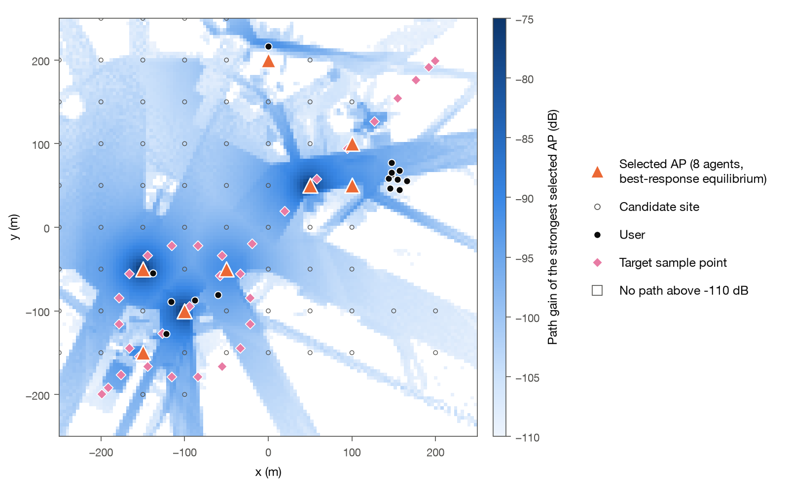
</p>
<p align="center"><em>Scenario 0 with a team of 8 agents: path gain of the strongest selected
AP on the 4 m ground grid, the 345 valid candidate positions (projected on the ground), the
placement that best-response dynamics reach, 15 users and 32 target sample points
(<code>scripts/make_figures.py --only teaser</code>).</em></p>

The work starts from

> F. Xu, S. Liu, Z. Mao, S. Shi, D. Xu, D. Wang, Y. Huang, "Access Point Deployment for
> Localizing Accuracy and User Rate in Cell-Free Systems", Workshop on Integrated Sensing
> and Communication Systems for 6G at ACM MobiCom '24,
> [doi:10.1145/3636534.3698221](https://doi.org/10.1145/3636534.3698221)

whose implementation (2-D geometry, Fisher-information determinant, Euclidean-distance
rate, SAC and baselines) is in
[OdurShi/cell-free-isac-ap-deployment](https://github.com/OdurShi/cell-free-isac-ap-deployment).
This repository takes the problem in two steps: first to a ray-traced 3-D scene (the
simulator), then from one learning agent that outputs all coordinates to a team of agents
on the simulator's candidate sites (the placement method).

| | Paper | Simulator (`simulation/`) | Team-game placement (`src/cfisac_ma/`) |
|---|---|---|---|
| Geometry | 2-D, 50 m square, placement on a grid | 3-D, 500 m x 500 m urban scene (Sionna's built-in `etoile` scene), 11 x 11 x 7 = 847 candidate AP positions at heights 5-35 m | the 345 candidate positions of the simulator whose map is at most 80% blocked |
| Channel to the users | distance-based (`1/d^2`) | path gain from a ray-traced database (28 GHz, 4 m grid, 125 x 125 cells), with a blockage threshold and an indoor penetration loss | the same database (compact copy in `data/`), blockage threshold -110 dB, users on outdoor cells |
| Sensing | determinant of a 2-D Fisher information matrix | determinant of a 3-D matrix built from the same sum of unit vectors, each Tx-Rx pair weighted by free-space gains | D-optimality `mean_p log det(J_p + eps I)` of the same pair matrices over 32 target sample points; every AP transmits and receives, split roles implemented as well |
| Users / targets | 3 users, 1 target on a circle | 15 users drawn around three hotspots, 2 targets (circle and line) | 15 users per seeded scenario (5 to 60 in E3), 16 sample points on each of the two target trajectories |
| Objective | product of rate and sensing terms | sum of a normalised rate term and a normalised `log10` sensing term, minus a penalty for the distance between the action and the candidate site it is snapped to | `lam * R(S)/R(V) + (1 - lam) * (L(S) - L(empty))/(L(V) - L(empty))` on sets of sites; max-min variant |
| Optimisers | SAC, DDPG, TD3, A2C | SAC (`train.py`), simulated annealing and a genetic algorithm (`compare_baselines.py`) | best response, sampled best response, bandit learners with team and difference rewards, two-phase best response; greedy, simulated annealing, genetic algorithm, random search, exhaustive search |

<p align="center">
  
  &nbsp;&nbsp;
  
</p>
<p align="center"><em>The scene of the simulator and one of its ray-traced radio maps.</em></p>

### The placement method

**Question.** `N` APs have to be placed on candidate sites of a ray-traced scene so that users
get a high rate and aerial targets can be localised well. Can this be solved by a team of
agents with guarantees that follow from the structure of the objective, and how does that
compare with the centralised black-box optimisers that the scene's simulator uses (simulated
annealing, a genetic algorithm), with greedy selection and with random search?

**Model.** The team utility of a set `S` of occupied sites is

    U(S) = lam * R(S) / R(V) + (1 - lam) * (L(S) - L(empty)) / (L(V) - L(empty))

with the sum rate `R(S) = sum_k log2(1 + 1e12 * sum_{a in S} beta_{a,k})` on ray-traced path
gains `beta` (0 below -110 dB), the D-optimality sensing value
`L(S) = mean_p log det(J_p(S) + eps I)` of the information matrix
`J_p(S) = sum_{m,n in S} w_m w_n (u_m + u_n)(u_m + u_n)^T` over target sample points `p`, and
`V` the set of all 345 valid candidate sites. Both terms are 0 for the empty set and 1 for
`V`. A max-min variant replaces `R` by the minimum user rate, and a split-role variant of `J`
(disjoint transmit and receive sets) is implemented as well. Details: [docs/theory.md](docs/theory.md),
[docs/notes.md](docs/notes.md).

**What is in the repository.**

* `simulation/`: the ray-traced simulator. `generate_offline_database.py` traces one radio
  map per candidate position; `isac_env.py` is the deployment environment on that database;
  `train.py`, `compare_baselines.py` and `main_app.py` are SAC training, the simulated
  annealing and genetic-algorithm baselines and the desktop GUI
  ([The simulator](#the-simulator));
* `cfisac_ma`, a NumPy package with the vectorised objective, the team methods (exact and
  sampled best response, bandit learners with team and difference rewards, a two-phase best
  response for the max-min variant), the centralised methods (greedy, simulated annealing,
  genetic algorithm, random search, exhaustive search with enumeration of all equilibria) and
  the estimators of submodularity ratio and curvature;
* seven experiments (E1-E7) with their result files, tables and figures, reproduced by one
  command from the shipped data;
* [docs/theory.md](docs/theory.md): five propositions with proofs and numerical checks;
  `tests/test_propositions.py` checks each of them exhaustively on small instances;
* [docs/notes.md](docs/notes.md): assumptions, settings, what was run, what changed between
  the two passes over the experiments, limitations;
  [docs/frontier.md](docs/frontier.md): the literature survey behind the positioning.

**What the study finds** (numbers and files in [Main results](#main-results)).

1. The team game is an exact potential game, so best-response dynamics always stop at a pure
   Nash equilibrium. Guarantees (equilibria at least half the optimum, greedy at least
   `1 - 1/e`) hold for the parts of the objective that are provably monotone submodular: the
   sum rate, and the sensing term with split roles in one role for a fixed set in the other.
   The utility that is optimised uses joint roles and is not submodular; for it the measured
   submodularity ratio, diminishing-return ratio and curvature are reported together with the
   bounds they imply and with the empirical ratios.
2. Empirically the equilibria are close to optimal: on small instances with a brute-force
   optimum, the worst equilibrium of any instance is within 3.3% of the optimum.
3. On the full problem, best response, sampled best response and a tuned simulated annealing
   end at the same utility within 0.01%; greedy is 0.1-0.6% lower for a sixth of the
   evaluations, and best response started from the greedy placement closes most of that gap.
   The bandit learners are clearly worse at the same budget.
4. The team methods are not better optimisers than a well-tuned simulated annealing, whose
   proposals are unilateral deviations of the same game. What the formulation adds is the
   convergence certificate, the structural analysis, warm starts, and a potential that can be
   reshaped: for the max-min variant plain best response and greedy stall on plateaus, and
   best response on a saturated-rate potential is the best method tested.

Findings 5 to 8, on operating the deployed network, are in
[The operation study](#the-operation-study) below.

None of the ingredients is claimed to be new here: sensing-aware placement, learning-based
placement, site selection on ray-traced maps, submodular guarantees and game-theoretic
placement all exist. The contribution is the combination evaluated here: one objective on
one ray-traced scene, analysed for its structure and optimised by team and centralised
methods under a common count of objective evaluations.

### The operation study

<p align="center">
  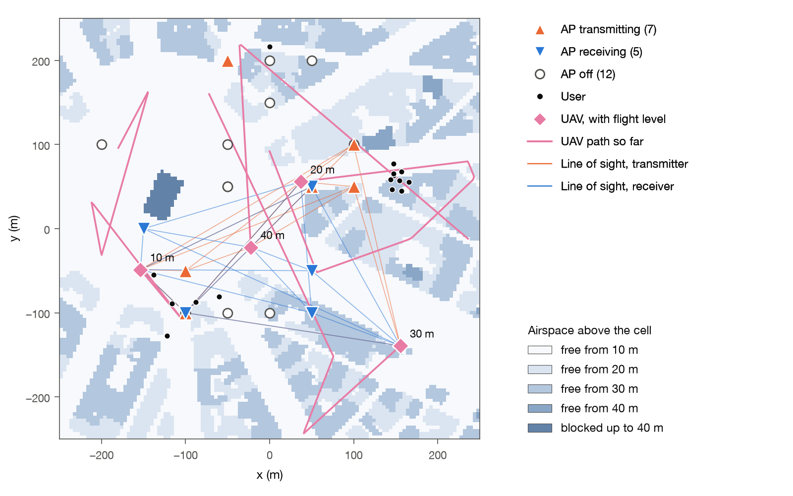
</p>
<p align="center"><em>Scenario 0 of experiment E10 at slot 120: 24 deployed APs under the
distributed controller, 15 users, four UAVs at 10, 20, 30 and 40 m with their paths, and the
lines of sight between the active APs and the UAVs. The shading shows from which flight
level the airspace above a cell is free
(<code>scripts/make_figures.py --only teaser_operation</code>).</em></p>

The placement study ends with the finding that, for one-shot placement, the team methods
are not better optimisers than a tuned simulated annealing. It also has two modelling
weaknesses: the sensing links are free-space links without blockage, and every AP transmits
and receives. The operation study removes both and moves the question.

**Question.** Where does a multi-agent (per-AP, distributed) method have a real advantage
in cell-free ISAC? The hypothesis was: not in one-shot planning but in operation, in the
repeated mode decisions of already deployed APs under blockage, moving targets, limited
decision latency and failures, where the ray-traced geometry makes interactions local.

**Model.** `D` APs are deployed. In every slot of 0.5 s each AP is off, transmits or
receives (half-duplex); `T` is the set of transmitters and `R` the set of receivers. The
team utility of a mode profile is

    U = lam * R(T) / R_ref + (1 - lam) * mean_q s_q(T, R) / S_ref - c_tx |T| - c_rx |R|

with the sum rate `R(T) = sum_k log2(1 + 1e12 * sum_{i in T} beta_{i,k})` of static ground
users on the ray-traced path gains, the sensing value
`s_q = log det(J_q + eps I) - 3 log eps` of UAV `q`,
`J_q = sum_{m in T} sum_{n in R} v_m v_n w_m w_n (u_m + u_n)(u_m + u_n)^T`, and an energy
cost per active AP. `v` is the line of sight of an AP to the UAV, taken from exact
visibility tests on the scene (`data/aerial_los.npz`): a transmitter-receiver pair
contributes only if both see the target. The UAVs fly random-waypoint paths through the
free airspace of their flight level. With a physical reading of the simulator's sensing
scale (a bistatic-range Fisher information in 1/m^2, [docs/theory.md](docs/theory.md),
Section 11) the sensing quality is also reported as a Bayesian position error bound (PEB)
in metres. Exact definitions: [docs/notes.md](docs/notes.md), Section 6.

**What is added to the repository.**

* `cfisac_ma/aerial.py` and `data/aerial_los.npz`: line-of-sight tables of the 345 valid
  sites at four flight levels, planning points, UAV paths, the physical scale and the PEB;
  blockage as an option of the placement problem (off by default, so E1-E7 are unchanged);
* `cfisac_ma/operation.py`: the mode-selection game with incremental evaluation, the
  interaction graph, distributed methods (sequential best response, best response on a
  colouring, best response with pair moves, log-linear learning) and central ones (greedy,
  simulated annealing, random search, exhaustive search with all equilibria), and the
  online controllers;
* five experiments (E8-E12) with result files, tables and figures
  ([Operating the deployed network](#operating-the-deployed-network));
* [docs/theory.md](docs/theory.md), Part II: Propositions 6-9 with proofs;
  `tests/test_propositions_op.py` checks them on small instances.

**What the operation study finds** (numbers and files in
[Operating the deployed network](#operating-the-deployed-network)).

5. Blockage matters for small deployments: a placement planned with free-space sensing
   loses 5.7% of the blockage-aware utility with 4 APs and 0.4% with 16 on the simulator's
   target trajectories, and its median position error bound is 51 m instead of 5.8 m with
   4 APs.
6. The mode game is an exact potential game for any costs, and an AP can compute its best
   response from the aggregates of the users it reaches and the targets it sees. The
   locality that the hypothesis relied on is not there: most deployed APs see the same
   UAVs, the interaction graph of 24 APs has a density of 0.97, and best response on a
   colouring is a sequential sweep.
7. Unilateral equilibria can be arbitrarily bad (all APs off is an equilibrium of the
   sensing-only game in every instance; best response and greedy started there stay
   there). Joint moves of two adjacent APs remove this failure; with them the worst stable
   profile of any small instance is 2.0% below the exhaustive optimum for the default
   utility.
8. In online tracking a distributed controller that converges within a slot and central
   simulated annealing with the same number of evaluations and no delay reach the same
   utility (0.9962 and 0.9967 of the best known at 10 m/s). The distributed controller is
   ahead only through latency: central control is behind once its decisions are one slot
   old (0.9945 at 10 m/s, 0.9870 at 40 m/s). If only one or two sub-rounds fit into a slot,
   central control with up to 4 slots of delay is better at every speed tested. The
   distributed controller sends about 20 messages per slot where the central one sends one
   command.

The hypothesis is therefore supported in one respect (no central round trip) and
contradicted in the other (locality).

## Installation

Python 3.10 or newer. The placement package needs NumPy and Matplotlib; the development
extra adds pytest and ruff. With [uv](https://docs.astral.sh/uv/):

```bash
uv venv --python 3.12 .venv
uv pip install -p .venv/bin/python -e ".[dev]"
source .venv/bin/activate
```

With pip:

```bash
python -m venv .venv && source .venv/bin/activate
pip install -e ".[dev]"
```

The package reads the data from the `data/` directory of the clone (or from the directory
named by `CFISAC_MA_DATA`), so install it in editable mode from a clone.

Only `scripts/raytrace_scene.py`, which produced the line-of-sight tables in `data/`, needs
Sionna RT (`pip install -e ".[rt]"`); every experiment runs on the shipped files.

The simulator scripts have their own requirements (classic Gym, PyTorch, Sionna, the GUI
toolkits), listed under [The simulator](#the-simulator). The package works with NumPy 1.24
and newer, so one environment with `numpy<2` serves both.

## Quick start

```bash
python scripts/quickstart.py        # about a second
```

```text
345 valid candidate sites, 15 users, 32 target points, lam = 0.5
random start        U = 0.5085  sum rate = 80.7 bit/s/Hz  sensing L = 0.99 nats
best response       U = 0.7116  sum rate = 126.0 bit/s/Hz  sensing L = 7.88 nats
                    8 moves, 5520 evaluations, equilibrium certified: True
greedy              U = 0.7116  sum rate = 126.0 bit/s/Hz  sensing L = 7.88 nats
                    2732 evaluations
greedy + best resp. U = 0.7116  sum rate = 126.0 bit/s/Hz  sensing L = 7.88 nats
                    0 further moves, 5492 evaluations in total
sites of the best-response equilibrium (x, y, z in m):
  (  -150,   -150,   35)
  (  -150,    -50,    5)
  (  -100,   -100,    5)
  (   -50,    -50,   35)
  (     0,    200,   35)
  (    50,     50,    5)
  (   100,     50,   35)
  (   100,    100,   30)
```

The same from Python:

```python
import numpy as np
from cfisac_ma import centralized, team
from cfisac_ma.data import load_scene
from cfisac_ma.objective import Evaluator
from cfisac_ma.scenario import make_problem, make_scenario

scene = load_scene()  # 345 valid candidate sites
problem = make_problem(scene, make_scenario(scene, seed=0, n_users=15), lam=0.5)

start = team.random_placement(np.random.default_rng(0), problem.n_sites, 8)
ev = Evaluator(problem)  # counts objective evaluations
eq = team.best_response_dynamics(ev, start)  # 8 agents, one site each
print(eq.value, eq.n_moves, eq.n_evals, eq.converged)
print(problem.components(eq.placement).rate_sum, scene.positions[eq.placement])

greedy = centralized.greedy(Evaluator(problem), 8)
print(greedy.value, greedy.n_evals)
```

## The simulator

`simulation/` is the ray-traced 3-D deployment simulator that the placement method takes its
scene, channel database and physical model from.

| Path | Purpose |
|---|---|
| `simulation/isac_env.py` | `CellFreeISAC3DEnv`: loads the database, places users and targets, maps a continuous action to distinct candidate sites, returns the reward and its parts (`sum_rate`, `min_rate`, `fim_det`, ...). Classic Gym API. |
| `simulation/train.py` | SAC training on the environment (2000 episodes of 200 steps); writes the per-episode best reward to `drl_real_curve.npy`. |
| `simulation/compare_baselines.py` | Simulated annealing and a genetic algorithm on the same reward; plots their histories together with the stored SAC curve to `real_fluctuating_comparison.png`. |
| `simulation/generate_offline_database.py` | Ray-traces one radio map per candidate position with `sionna.rt.RadioMapSolver` and writes `paris_pg_database_3d.npy` and `candidate_positions_3d.npy`. |
| `simulation/main.py` | Single radio-map example (one transmitter), writes `coverage_map_result.png`. |
| `simulation/check_database.py` | Diagnostics of a database: dead positions, sparsity, value range, NaN / Inf, three sample heat maps. |
| `simulation/view_heatmap.py`, `simulation/render_topdown.py` | Heat maps of one candidate position at two heights; top-down map reconstructed from the maximum over positions. |
| `simulation/preview_model.py` | Opens the mesh of the Sionna `etoile` scene in an Open3D viewer. |
| `simulation/test_env.py` | Five random steps in the environment, printed to the console. |
| `simulation/main_app.py` | CustomTkinter desktop GUI: scene preview, database generation or loading, heat maps, SA and GA optimisation, replay of the stored SAC training curve, 3-D deployment view. |
| `scenes/` | `scene.xml`, `buildings.ply`, `ground.ply`: scene geometry kept with the code (the scripts load Sionna's built-in `etoile` scene). |
| `docs/figures/` | Sample outputs: radio map, reconstructed map, scene views, SA / GA / SAC comparison plots. |
| `docs/implementation_notes.md` | Technical notes on the simulator code, its data files and its release. |
| `tests/test_isac_env.py` | Tests of the environment on the shipped databases. |
| `tests/test_simulator_link.py` | Checks of the placement package against the methods of the environment: candidate sites, user rates, sensing information matrix, target trajectories. |

**Requirements.** `requirements.txt` lists what the imports need; versions are unpinned
except where the code depends on an API:

* `isac_env.py`, `train.py`, `compare_baselines.py`: NumPy, the classic `gym` package
  (`reset()` returns the observation, `step()` returns four values; `gym==0.26.2` with
  `numpy<2`), PyTorch, Matplotlib.
* Ray tracing (`main.py`, `generate_offline_database.py`, database generation in
  `main_app.py`): `sionna` with the `sionna.rt.RadioMapSolver` interface and the built-in
  `sionna.rt.scene.etoile` scene, and `tensorflow`. The scripts select CPU execution
  (`CUDA_VISIBLE_DEVICES=-1`).
* GUI and viewers: `customtkinter`, `pyvista`, `scipy`, `open3d`, a Tk display.

```bash
pip install "numpy<2" "gym==0.26.2" torch matplotlib      # environment, training, baselines
pip install -r requirements.txt                            # everything, including Sionna and the GUI
```

**Usage.** The scripts locate their data relative to the working directory, so run them from
`simulation/`:

```bash
cd simulation
python test_env.py            # five random steps, prints reward and its parts
python train.py               # SAC training, writes drl_real_curve.npy
python compare_baselines.py   # SA and GA together with the stored SAC curve
python main_app.py            # desktop GUI
```

Running `generate_offline_database.py` or `train.py` overwrites the corresponding `.npy`
files.

## Data

The repository ships the data that the simulator, the experiments and the figures use.

| File | Shape, type | Content | Used by |
|---|---|---|---|
| `simulation/paris_pg_database_3d.npy` | (11, 11, 7, 125, 125) float32, 53 MB | linear path gain from each of the 847 candidate positions to a 125 x 125 grid (4 m cells over [-250, 250] m) at 1.5 m height | the simulator scripts; source of the compact database |
| `simulation/candidate_positions_3d.npy` | (847, 3) float64 | x, y, z of the candidate positions; x, y in [-250, 250] m, z in [5, 35] m | the simulator scripts |
| `simulation/drl_real_curve.npy` | (2000,) float64 | output of `train.py`: best per-step reward of each training episode | `compare_baselines.py`, `main_app.py` |
| `simulation/paris_pg_database.npy`, `simulation/candidate_positions.npy` | (121, 125, 125) float16; (121, 3) float64 | database and positions of an earlier 2-D version, kept for reference | - |
| `data/pathgain_db_u16.npz` | (847, 125, 125) uint16 and a (125, 125) mask, 5.1 MB | the same path gains in dB, quantised to 16 bits; blocked entries (below -110 dB) are code 0; plus the mask of outdoor cells | `cfisac_ma`, experiments E1-E7, figures |
| `data/candidate_positions_3d.npy` | (847, 3) float64 | byte-identical copy of the simulator's file | `cfisac_ma` |
| `data/manifest.json` | - | SHA-256 values of source and shipped files, encoding parameters, error against the source | `tests/test_data.py` |
| `data/aerial_los.npz` | bit-packed booleans (4, 345, 15625) and (345, 15625), a (4, 125, 125) mask, 385 kB | line of sight from each valid site to each cell centre at the flight levels 10, 20, 30, 40 m and at the user height; cells that are free at each level | `cfisac_ma.aerial`, experiments E8-E12, `figures/teaser_operation.png` |
| `data/aerial_manifest.json` | - | SHA-256 of `aerial_los.npz` and of the database it belongs to, software versions, statistics | `tests/test_aerial.py` |

`scripts/build_database.py` derives the compact database from the simulator's array. The
blocked mask and the set of 345 valid positions are identical to the source, and the largest
error of an unblocked gain is 0.000288 dB (`data/manifest.json`); `tests/test_data.py`
compares the two files entry by entry. The derivation is described step by step in
[data/README.md](data/README.md).

`scripts/raytrace_scene.py` writes the line-of-sight tables with exact visibility tests on
Sionna's `etoile` scene, compares the simulator's database with a new trace
(`results/e8_database_check.json`) and compares the table lookup of the package with exact
tests (`results/e8_los_lookup_check.json`); [data/README.md](data/README.md) describes the
arrays.

Scenarios are generated from seeds: users from the simulator's hotspot mixture with
`numpy.random.default_rng(seed)`, targets from 16 sample points on each of the simulator's two
trajectories (`cfisac_ma/scenario.py`). The operation study adds seeded planning points,
planning users and UAV paths (`cfisac_ma/aerial.py`, `cfisac_ma/experiments_op.py`).

## Reproducing the results

All commands run on the shipped data, on a CPU.

| Item | Command | Output |
|---|---|---|
| Everything below (both suites: tuning, E1-E12, figures, tables) | `python scripts/reproduce_all.py` | `results/`, `figures/` |
| Placement suite only (tuning grids, E1-E7, their figures, tables) | `python scripts/reproduce_all.py --suite placement` | `results/`, `figures/`, `results/runtime.json` |
| Operation suite only (calibration and tuning, E8-E12, their figures, tables) | `python scripts/reproduce_all.py --suite operation` | `results/`, `figures/`, `results/runtime_operation.json` |
| E1 structure: violations, submodularity ratio, curvature | `python scripts/run_e1_structure.py` | `results/e1_structure.json`, `figures/e1_structure.png`, `figures/e1_eps.png` |
| E2 small instances with brute-force optimum and all equilibria | `python scripts/run_e2_small_instances.py` | `results/e2_small_instances.json`, `figures/e2_small_instances.png` |
| E3 full problem, N = 4, 8, 12, 16; user counts; credit assignment | `python scripts/run_e3_full_problem.py` | `results/e3_full_problem.json`, `figures/e3_*.png` |
| E4 rate versus sensing trade-off | `python scripts/run_e4_tradeoff.py` | `results/e4_tradeoff.json`, `figures/e4_tradeoff.png` |
| E5 adaptation to moved hotspots | `python scripts/run_e5_adaptation.py` | `results/e5_adaptation.json`, `figures/e5_adaptation.png` |
| E6 max-min variant | `python scripts/run_e6_maxmin.py` | `results/e6_maxmin.json`, `figures/e6_maxmin_*.png` |
| E7 statistical channel versus ray-traced maps | `python scripts/run_e7_channel_model.py` | `results/e7_channel_model.json`, `figures/e7_channel_model.png` |
| E8 blockage-aware sensing: placement with and without blockage, structure | `python scripts/run_e8_blockage.py` | `results/e8_blockage.json`, `figures/e8_blockage.png` |
| E9 equilibria of the mode game on small deployments | `python scripts/run_e9_mode_equilibria.py` | `results/e9_mode_equilibria.json`, `figures/e9_equilibria.png` |
| E10 online tracking: distributed against delayed central control | `python scripts/run_e10_online_tracking.py` | `results/e10_online_tracking.json`, `figures/e10_*.png` |
| E11 locality and scaling of the interaction graph | `python scripts/run_e11_locality.py` | `results/e11_locality.json`, `figures/e11_*.png` |
| E12 failures and repair | `python scripts/run_e12_failures.py` | `results/e12_failures.json`, `figures/e12_failures.png` |
| Hyper-parameter grids on separate tuning scenarios | `python scripts/tune_baselines.py` | `results/tuning.json` |
| Cost calibration and grids of the operation study on the tuning scenarios | `python scripts/tune_operation.py` | `results/tuning_operation.json` |
| Figures from the result files (teaser included) | `python scripts/make_figures.py` | `figures/*.png` |
| Tables from the result files | `python scripts/make_tables.py` | `results/tables.md` |
| First-pass results (see [docs/notes.md](docs/notes.md)) | `python scripts/reproduce_all.py --settings pass1 --skip-tuning --skip-figures` | `results/pass1/` (E1-E7), `results/operation_pass1/` (E8-E12) |
| Line-of-sight tables and checks of the database and of the lookup (needs Sionna RT) | `python scripts/raytrace_scene.py --los --check-database --check-lookup` | `data/aerial_los.npz`, `data/aerial_manifest.json`, `results/e8_database_check.json`, `results/e8_los_lookup_check.json` |
| Compact database from the simulator's arrays in `simulation/` | `python scripts/build_database.py` | `data/` |
| Tests and lint | `pytest`, `ruff check .` | |

Every script accepts `--jobs N` (worker processes, default up to 10) and `--quick` (reduced
sizes for a smoke test, written to `results/pass2-quick/`). Results do not depend on the
number of processes: every task derives its random streams from its own arguments. The
placement suite took 476.2 s of wall-clock time on a 10-core laptop (`results/runtime.json`,
which also lists the time of each step and the machine), the operation suite 277.5 s
(`results/runtime_operation.json`).

## Main results

All numbers in this section are copied from [`results/tables.md`](results/tables.md), which
`scripts/make_tables.py` writes from the JSON files named in the headings; table rows are
verbatim (`tests/test_repository.py` checks this). Entries are means with 95% Student-t
intervals over scenarios. Costs are counted in objective evaluations: one evaluation is the
utility of one placement, for every method, including each candidate of a best-response
sweep and each counterfactual of a difference reward.

### E1: structure of the objective (`results/e1_structure.json`)

<p align="center">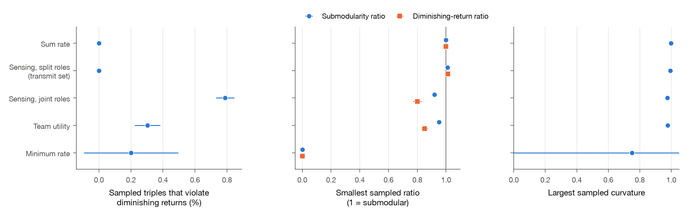</p>

<!-- results:begin -->
| Set function | Violating triples (%) | Submodularity ratio | Diminishing-return ratio | Curvature | Implied greedy factor | Implied equilibrium factor |
|---|---|---|---|---|---|---|
| Sum rate `R` | 0.00 [0.00, 0.00] | 1.000 | 1.000 | 0.998 | 0.633 | 0.500 |
| Sensing, split roles (transmit set, receive set fixed) | 0.00 [0.00, 0.00] | 1.007 | 1.009 | 0.995 | 0.633 | 0.500 |
| Sensing, joint roles `L` | 0.79 [0.73, 0.85] | 0.903 | 0.722 | 0.980 | 0.599 | 0.320 |
| Team utility `U` (lam = 0.5) | 0.30 [0.22, 0.38] | 0.937 | 0.803 | 0.981 | 0.613 | 0.377 |
| Minimum rate | 0.20 [0.00, 0.50] | 0.000 | 0.000 | 1.000 | 0.000 | 0.000 |
<!-- results:end -->

Sampled triples `(S, T, a)` with `S` a subset of `T` that violate
`gain(a | S) >= gain(a | T)`; smallest sampled ratios and largest sampled curvature over
10 scenarios (definitions in [docs/theory.md](docs/theory.md), Section 6). The sum rate and
the split-role sensing term are provably monotone submodular and show no violation; for them
the guarantees 1/2 (equilibria) and `1 - 1/e` (greedy) hold. The joint-role sensing term and
the team utility are not submodular. The last two columns are the factors that the sampled
ratios and curvature imply for greedy (theorem of Bian et al., 2017) and for equilibria
(Proposition 5c); they are computed from sampled extremes and are therefore optimistic
estimates of bounds, not guarantees. The violations occur almost only when the smaller set
is empty or a single site (6.51% and 0.51% of the triples for the sensing term, 0.04% for
two sites, none in the samples beyond), because the first access points complement each
other until the information matrix has full rank. `figures/e1_eps.png` and the E1 section of
`results/tables.md` show how the violations grow with the regulariser `eps`.

### E2: small instances with the exact optimum (`results/e2_small_instances.json`)

<p align="center">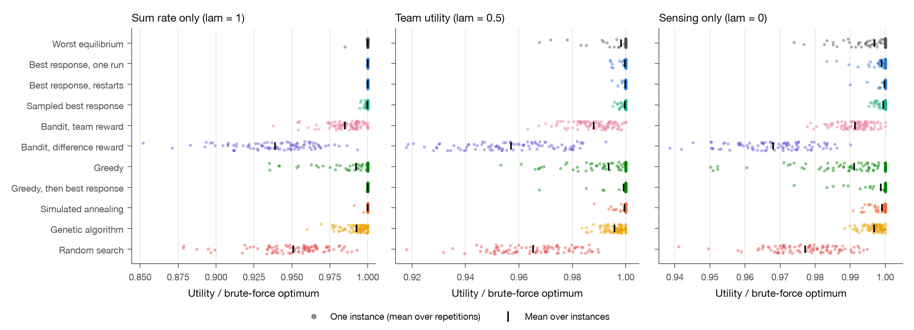</p>

<!-- results:begin -->
| Utility / optimum | lam = 1 (sum rate only) | lam = 0.5 (team utility) | lam = 0 (sensing only) |
|---|---|---|---|
| Worst pure Nash equilibrium | 0.9998 [0.9995, 1.0000], min 0.9847 | 0.9982 [0.9971, 0.9994], min 0.9677 | 0.9970 [0.9958, 0.9981], min 0.9739 |
| Best response (one run) | 1.0000 [1.0000, 1.0000], min 0.9993 | 0.9996 [0.9994, 0.9999], min 0.9718 | 0.9990 [0.9984, 0.9996], min 0.9739 |
| Best response (restarts) | 1.0000 [1.0000, 1.0000], min 0.9993 | 0.9999 [0.9997, 1.0000], min 0.9852 | 0.9998 [0.9995, 1.0000], min 0.9739 |
| Sampled best response | 0.9996 [0.9994, 0.9998], min 0.9732 | 0.9996 [0.9994, 0.9998], min 0.9789 | 0.9995 [0.9993, 0.9997], min 0.9766 |
| Bandit learners, team reward | 0.9848 [0.9823, 0.9873], min 0.8935 | 0.9879 [0.9863, 0.9896], min 0.9310 | 0.9913 [0.9903, 0.9924], min 0.9562 |
| Bandit learners, difference reward | 0.9390 [0.9335, 0.9445], min 0.7916 | 0.9570 [0.9534, 0.9607], min 0.8773 | 0.9681 [0.9658, 0.9703], min 0.9120 |
| Greedy | 0.9924 [0.9891, 0.9957], min 0.9350 | 0.9936 [0.9914, 0.9958], min 0.9532 | 0.9911 [0.9886, 0.9936], min 0.9501 |
| Greedy, then best response | 1.0000 [1.0000, 1.0000], min 0.9993 | 0.9993 [0.9984, 1.0000], min 0.9677 | 0.9988 [0.9979, 0.9996], min 0.9739 |
| Simulated annealing | 0.9999 [0.9997, 1.0000], min 0.9847 | 0.9995 [0.9991, 0.9998], min 0.9677 | 0.9991 [0.9986, 0.9995], min 0.9768 |
| Genetic algorithm | 0.9925 [0.9909, 0.9941], min 0.8951 | 0.9958 [0.9950, 0.9966], min 0.9508 | 0.9968 [0.9963, 0.9974], min 0.9736 |
| Random search | 0.9508 [0.9459, 0.9558], min 0.8296 | 0.9652 [0.9622, 0.9682], min 0.8872 | 0.9772 [0.9752, 0.9792], min 0.9163 |
<!-- results:end -->

90 instances (3, 4 or 5 agents, 32 random candidate sites); the optimum and all pure Nash
equilibria are found by enumerating all subsets. "Worst pure Nash equilibrium" is a property
of the game, not of an algorithm. For `lam = 1` the guarantees apply (one half for
equilibria, `1 - 1/e` for greedy); the worst equilibrium of any instance is at 0.9847 of the
optimum and the worst greedy result at 0.9350. For the other two columns no guarantee is
claimed. The factors implied by the sampled structure (E1) are 0.377 for equilibria and
0.613 for greedy at `lam = 0.5`, and 0.320 and 0.599 for sensing only; the worst equilibria
are at 0.9677 and 0.9739 of the optimum and the worst greedy results at 0.9532 and 0.9501.

### E3: full problem (`results/e3_full_problem.json`)

<p align="center">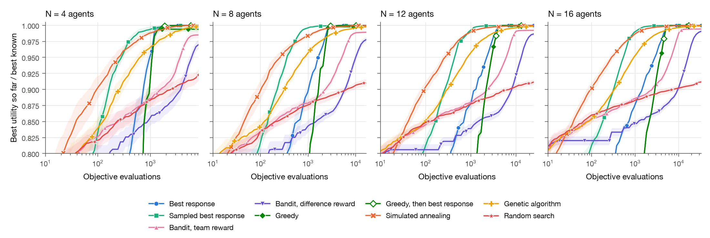</p>

<!-- results:begin -->
| N = 8 (budget 16560) | Final utility / best known | Runs at best known (%) | Reach 99% (%) | Evaluations to 99% | Reach 99.9% (%) | Evaluations to 99.9% | Evaluations used |
|---|---|---|---|---|---|---|---|
| Best response (restarts) | 1.0000 [0.9999, 1.0000] | 97 | 100 | 2378 [2315, 2442] | 97 | 3679 [2706, 4652] | 16560 |
| Sampled best response | 1.0000 [1.0000, 1.0000] | 97 | 100 | 705 [645, 765] | 100 | 2677 [1515, 3840] | 16515 |
| Bandit learners, team reward | 0.9892 [0.9871, 0.9912] | 0 | 53 | 8333 [7705, 8962] | 0 | - | 16545 |
| Bandit learners, difference reward | 0.9777 [0.9738, 0.9816] | 0 | 8 | 12076 [9049, 15103] | 0 | - | 16417 |
| Greedy | 0.9978 [0.9961, 0.9995] | 40 | 90 | 2463 [2439, 2487] | 55 | 2637 [2580, 2693] | 2732 |
| Greedy, then best response | 0.9999 [0.9997, 1.0000] | 95 | 100 | 2502 [2441, 2563] | 95 | 3128 [2648, 3608] | 6562 |
| Simulated annealing | 0.9999 [0.9997, 1.0000] | 87 | 100 | 1599 [1040, 2158] | 92 | 5426 [4422, 6430] | 16560 |
| Genetic algorithm | 0.9978 [0.9973, 0.9984] | 18 | 98 | 4518 [3781, 5255] | 35 | 11199 [9403, 12994] | 16560 |
| Random search | 0.9106 [0.9054, 0.9157] | 0 | 0 | - | 0 | - | 16560 |
<!-- results:end -->

20 scenarios, 3 repetitions, 15 users, `lam = 0.5`; every method may use `6 N |V|`
evaluations. The optimum is unknown at this size; "best known" is the best utility found by
any run on the scenario. Tables for N = 4, 12, 16 and for 5 to 60 users are in
`results/tables.md`; `figures/e3_final.png` and `figures/e3_users.png` show them.

<!-- results:begin -->
| N | Improving moves to equilibrium | Evaluations to certified equilibrium | One sweep (N x 345) | Utility at equilibrium | Moves after greedy | Utility gained after greedy |
|---|---|---|---|---|---|---|
| 4 | 4.38 [4.13, 4.63] | 2996 [2845, 3146] | 1380 | 0.5958 [0.5875, 0.6042] | 0.90 [0.40, 1.40] | 0.00345 [0.00104, 0.00585] |
| 8 | 8.73 [8.44, 9.02] | 6641 [6273, 7010] | 2760 | 0.7037 [0.6975, 0.7100] | 1.10 [0.44, 1.76] | 0.00148 [0.00031, 0.00265] |
| 12 | 12.72 [12.28, 13.15] | 9884 [9297, 10471] | 4140 | 0.7554 [0.7502, 0.7606] | 1.25 [0.73, 1.77] | 0.00078 [-0.00001, 0.00156] |
| 16 | 16.97 [16.51, 17.42] | 13892 [13171, 14613] | 5520 | 0.7885 [0.7839, 0.7931] | 1.35 [0.65, 2.05] | 0.00046 [0.00006, 0.00086] |
<!-- results:end -->

One best-response run from a random placement needs about one move per agent and between
two and three sweeps of evaluations, the last sweep being the equilibrium certificate
(`figures/e3_convergence.png`). Started from the greedy placement it makes about one more
move.

**Credit assignment.** Both bandit learners with the same number of joint samples:

<p align="center">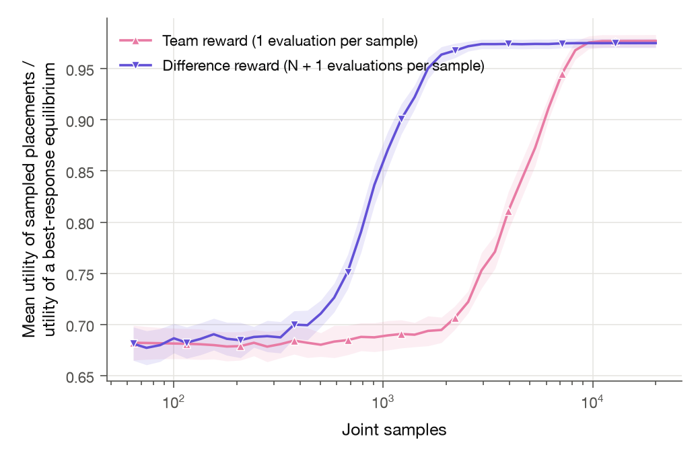</p>

<!-- results:begin -->
| Learner | after 434 samples | after 2947 samples | after 20000 samples | Greedy joint action at the end | Evaluations used |
|---|---|---|---|---|---|
| Team reward | 0.6822 [0.6676, 0.6967] | 0.7529 [0.7355, 0.7703] | 0.9771 [0.9710, 0.9832] | 0.9770 [0.9709, 0.9831] | 20001 |
| Difference reward | 0.6993 [0.6848, 0.7139] | 0.9740 [0.9693, 0.9786] | 0.9749 [0.9705, 0.9794] | 0.9749 [0.9705, 0.9794] | 180001 |
<!-- results:end -->

Per joint sample the difference reward learns several times faster. Each of its samples
costs `N + 1 = 9` evaluations, which more than cancels the advantage: at the common
evaluation budget of the E3 table above the team-reward learner is ahead. Both stop short of
the equilibria that best response finds.

### E4: rate versus sensing (`results/e4_tradeoff.json`)

<p align="center">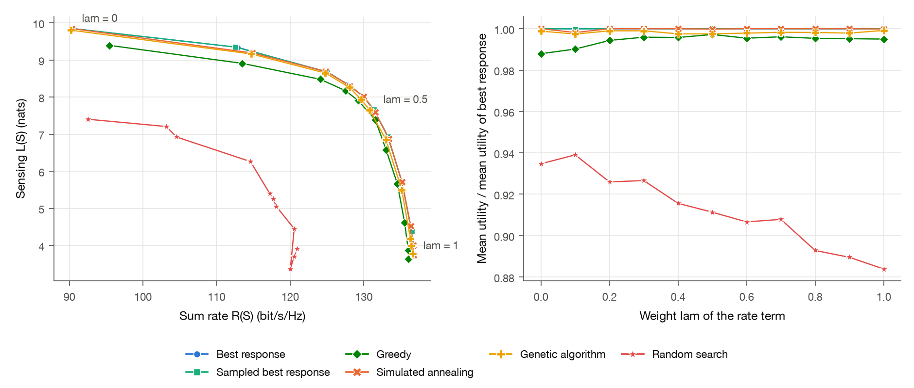</p>

<!-- results:begin -->
| lam | Sum rate, best response (bit/s/Hz) | Sensing L, best response (nats) | U: Best response (restarts) | U: Sampled best response | U: Greedy | U: Simulated annealing | U: Genetic algorithm | U: Random search |
|---|---|---|---|---|---|---|---|---|
| 0 | 90.4 [82.2, 98.7] | 9.85 [9.85, 9.85] | 0.6730 | 0.6730 | 0.6648 | 0.6730 | 0.6722 | 0.6291 |
| 0.5 | 131.4 [126.5, 136.2] | 7.66 [7.23, 8.09] | 0.7058 | 0.7058 | 0.7038 | 0.7057 | 0.7040 | 0.6432 |
| 1 | 136.8 [131.8, 141.8] | 3.72 [2.85, 4.59] | 0.8099 | 0.8099 | 0.8059 | 0.8098 | 0.8093 | 0.7159 |
<!-- results:end -->

8 agents, 10 scenarios, eleven values of `lam` (three shown). The weight moves the placement
along a front between a sensing-only and a rate-only solution. With `lam = 0.5` best response
reaches a sum rate of 131.4 bit/s/Hz, against 136.8 for the rate-only placement, and a
sensing value of 7.66 nats, between 3.72 (rate only) and 9.85 (sensing only). A sensitivity
check in `results/tables.md` shows that the `lam = 0.5` operating point changes little when
`eps` varies over six orders of magnitude.

### E5: adaptation to moved users (`results/e5_adaptation.json`)

<p align="center">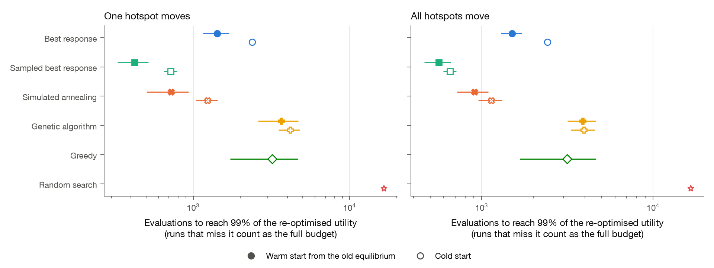</p>

<!-- results:begin -->
|  | Warm start: evaluations to target | reach it (%) | Cold start: evaluations to target | reach it (%) |
|---|---|---|---|---|
| Best response (restarts) | 1423 [1153, 1693] | 100 | 2375 [2323, 2427] | 100 |
| Sampled best response | 422 [328, 517] | 100 | 717 [648, 787] | 100 |
| Simulated annealing | 720 [506, 935] | 100 | 1236 [1042, 1431] | 100 |
| Genetic algorithm | 3647 [2591, 4704] | 100 | 4149 [3510, 4788] | 100 |
| Greedy | - | - | 3192 [1719, 4665] | 95 |
| Random search | - | - | 16560 [16560, 16560] | 0 |
<!-- results:end -->

One of the three hotspots moves to a random place and the users are redrawn (8 agents, 20
scenario pairs); the old equilibrium keeps 0.915 [0.885, 0.945] of the new best utility. The
target is 99% of the best utility known for the new users. A warm start from the old
equilibrium saves about 40% of the evaluations for best response, sampled best response and
simulated annealing. Exact best response is the slowest of the three because every move
costs a full sweep of 345 evaluations. When all three hotspots move the savings are smaller
(table in `results/tables.md`).

### E6: max-min variant (`results/e6_maxmin.json`)

<p align="center">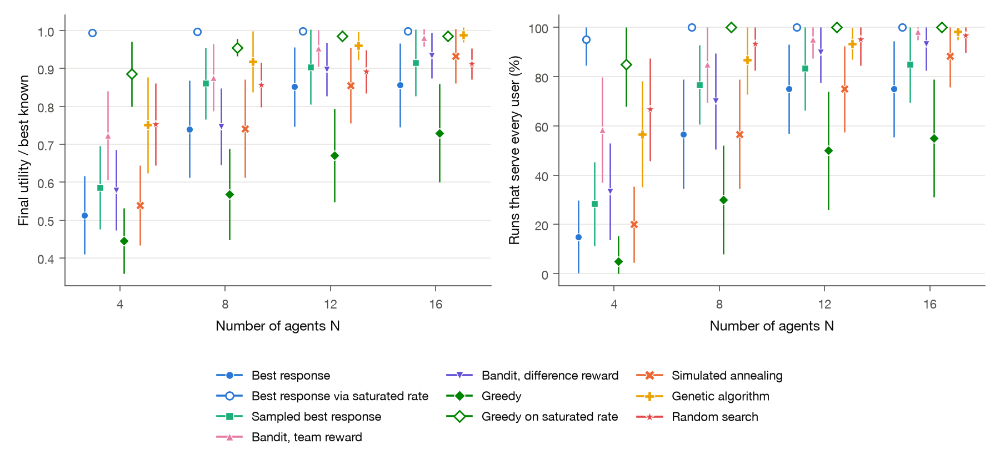</p>

<!-- results:begin -->
| Max-min utility | N = 4 | N = 8 | N = 12 | N = 16 |
|---|---|---|---|---|
| Best response (restarts) | 0.513 [0.410, 0.616]; 15% | 0.740 [0.612, 0.868]; 57% | 0.852 [0.747, 0.956]; 75% | 0.856 [0.746, 0.967]; 75% |
| Best response, saturated-rate potential first | 0.995 [0.989, 1.000]; 95% | 0.998 [0.995, 1.000]; 100% | 0.998 [0.996, 1.000]; 100% | 0.999 [0.998, 1.000]; 100% |
| Sampled best response | 0.586 [0.476, 0.695]; 28% | 0.861 [0.767, 0.956]; 77% | 0.904 [0.805, 1.000]; 83% | 0.915 [0.827, 1.000]; 85% |
| Bandit learners, team reward | 0.723 [0.606, 0.840]; 58% | 0.877 [0.789, 0.964]; 85% | 0.954 [0.906, 1.000]; 95% | 0.981 [0.957, 1.000]; 98% |
| Bandit learners, difference reward | 0.579 [0.473, 0.685]; 33% | 0.747 [0.647, 0.848]; 70% | 0.898 [0.828, 0.967]; 90% | 0.935 [0.874, 0.995]; 93% |
| Greedy | 0.445 [0.358, 0.532]; 5% | 0.568 [0.449, 0.688]; 30% | 0.671 [0.547, 0.794]; 50% | 0.730 [0.600, 0.860]; 55% |
| Greedy on saturated-rate surrogate | 0.885 [0.800, 0.971]; 85% | 0.955 [0.933, 0.978]; 100% | 0.985 [0.975, 0.996]; 100% | 0.986 [0.976, 0.996]; 100% |
| Simulated annealing | 0.539 [0.434, 0.644]; 20% | 0.742 [0.612, 0.872]; 57% | 0.855 [0.755, 0.955]; 75% | 0.933 [0.862, 1.000]; 88% |
| Genetic algorithm | 0.751 [0.624, 0.877]; 57% | 0.918 [0.838, 0.998]; 87% | 0.960 [0.923, 0.997]; 93% | 0.989 [0.969, 1.000]; 98% |
| Random search | 0.753 [0.645, 0.861]; 67% | 0.857 [0.799, 0.915]; 93% | 0.892 [0.835, 0.949]; 95% | 0.912 [0.871, 0.953]; 97% |
<!-- results:end -->

Final utility relative to the best known and, after the semicolon, the share of runs whose
placement gives every user a non-zero rate. With the minimum rate in place of the sum rate
the utility is flat wherever some user has no path to any selected AP, and a single move can
only leave that plateau if it serves all unserved users at once. Best response still
converges (Proposition 1) but stops on the plateau, and so do greedy and the fast-cooling
simulated annealing; random search does better than all three for N up to 12. Running best
response first on the saturated sum rate `sum_k min(r_k, tau)`, a monotone submodular
potential, and then on the max-min utility is the best method tested; greedy on the same
surrogate comes next for N up to 12. The two-phase best response is also the most expensive
of the good methods: the runs that reach 99% of the best known utility need 4466 (N = 4) to
20391 (N = 16) evaluations, while greedy on the surrogate stops after 1375 to 5401
(`figures/e6_maxmin_curves.png` and the full E6 tables in `results/tables.md`).

### E7: does the ray-traced map change the placement? (`results/e7_channel_model.json`)

<p align="center">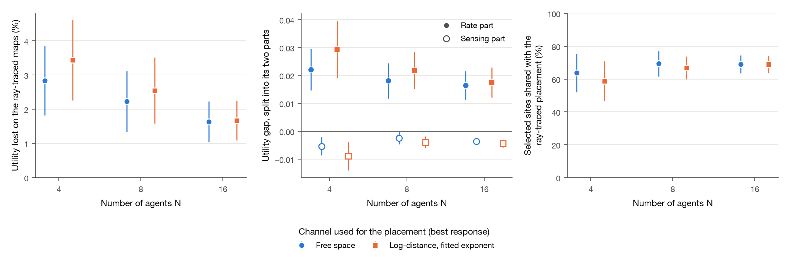</p>

The user links are replaced by a channel that ignores the scene: free space, or a
log-distance model with the free-space gain at 1 m as intercept and one exponent fitted by
least squares to the unblocked entries of the database (exponent 1.941, RMSE 2.77 dB; free
space has RMSE 3.06 dB; 32.8% of the entries of the valid sites are unblocked and enter the
fit). The placement is optimised on that channel and evaluated on the ray-traced utility.

<!-- results:begin -->
| lam | N | Channel used for the placement | Utility lost (%) | Gap, rate part | Gap, sensing part | Sum rate lost (%) | Sites shared (%) | Gain over a random placement kept (%) |
|---|---|---|---|---|---|---|---|---|
| 0.5 | 4 | Free space | 2.83 [1.82, 3.84] | 0.0221 [0.0147, 0.0295] | -0.0054 [-0.0086, -0.0021] | 6.32 [4.18, 8.45] | 64 [52, 75] | 93 [90, 95] |
| 0.5 | 4 | Log-distance | 3.44 [2.26, 4.62] | 0.0294 [0.0192, 0.0396] | -0.0089 [-0.0139, -0.0039] | 8.30 [5.43, 11.17] | 59 [47, 71] | 91 [88, 94] |
| 0.5 | 8 | Free space | 2.23 [1.35, 3.12] | 0.0181 [0.0118, 0.0244] | -0.0025 [-0.0047, -0.0003] | 4.73 [3.05, 6.41] | 69 [62, 77] | 93 [90, 96] |
| 0.5 | 8 | Log-distance | 2.54 [1.58, 3.51] | 0.0217 [0.0151, 0.0284] | -0.0040 [-0.0060, -0.0019] | 5.67 [3.91, 7.44] | 67 [60, 74] | 92 [89, 95] |
| 0.5 | 16 | Free space | 1.63 [1.04, 2.22] | 0.0165 [0.0113, 0.0216] | -0.0036 [-0.0048, -0.0024] | 3.91 [2.69, 5.13] | 69 [64, 74] | 94 [91, 96] |
| 0.5 | 16 | Log-distance | 1.67 [1.09, 2.25] | 0.0175 [0.0121, 0.0229] | -0.0044 [-0.0058, -0.0030] | 4.16 [2.87, 5.45] | 69 [64, 74] | 93 [91, 96] |
| 1 | 4 | Free space | 3.81 [1.93, 5.70] | 0.0272 [0.0138, 0.0405] | 0.0000 [0.0000, 0.0000] | 3.81 [1.93, 5.70] | 66 [54, 78] | 93 [89, 96] |
| 1 | 4 | Log-distance | 3.91 [2.08, 5.74] | 0.0279 [0.0149, 0.0410] | 0.0000 [0.0000, 0.0000] | 3.91 [2.08, 5.74] | 65 [53, 77] | 93 [89, 96] |
| 1 | 8 | Free space | 5.04 [3.59, 6.49] | 0.0403 [0.0289, 0.0518] | 0.0000 [0.0000, 0.0000] | 5.04 [3.59, 6.49] | 68 [62, 73] | 89 [85, 92] |
| 1 | 8 | Log-distance | 4.91 [3.68, 6.14] | 0.0393 [0.0296, 0.0490] | 0.0000 [0.0000, 0.0000] | 4.91 [3.68, 6.14] | 69 [64, 74] | 89 [86, 92] |
| 1 | 16 | Free space | 4.21 [2.87, 5.56] | 0.0364 [0.0249, 0.0480] | 0.0000 [0.0000, 0.0000] | 4.21 [2.87, 5.56] | 72 [68, 75] | 88 [84, 92] |
| 1 | 16 | Log-distance | 4.16 [2.84, 5.48] | 0.0360 [0.0246, 0.0473] | 0.0000 [0.0000, 0.0000] | 4.16 [2.84, 5.48] | 72 [69, 76] | 88 [85, 92] |
<!-- results:end -->

Best response on the statistical channel versus best response on the ray-traced maps, 20
scenarios (the table for greedy is in `results/tables.md`). The gap is small: a placement
chosen without the ray-traced maps loses 1.6-3.4% of the utility at `lam = 0.5` and 3.8-5.0%
of the sum rate at `lam = 1`, keeps 88-94% of the gain over a random placement, and shares
59-72% of its sites with the placement chosen on the maps. The loss is in the rate part;
the sensing part is slightly in favour of the statistical placements at `lam = 0.5` (negative
values) and offsets a part of it. The fitted exponent does not help compared with free
space. A distance-only channel cannot represent blockage, so the gap measured here is the
value of knowing which user is hidden from which site.

### Where the team formulation helps and where it does not

* **Helps: structure and certificates.** Convergence to a pure Nash equilibrium is guaranteed
  for any utility; a best-response run ends with a certificate that no single AP can be
  moved with gain. For the provably submodular parts the equilibrium and greedy guarantees
  apply; for the joint objective the measured ratios quantify how far it is from that case.
* **Helps: polishing and adaptation.** Best response after greedy removes most of greedy's
  remaining gap with about one extra move, and a warm start from the previous equilibrium
  saves about 40% of the evaluations after one hotspot moves.
* **Helps: the max-min variant, once the potential is reshaped.** Plain best response fails
  there; best response on the saturated-rate potential followed by the true utility is the
  best method tested.
* **Does not help: final utility on the sum-rate problem.** A tuned simulated annealing
  reaches the same utility and, for N of 8 and more, reaches 99% of it in fewer evaluations
  than exact best response. Its proposal is a unilateral deviation, so it is a randomised
  better-response dynamic of the same game; sampled best response behaves similarly and is
  the fastest method to 99%.
* **Does not help: cost of exact best response.** One move costs 345 evaluations. Greedy
  needs one sweep in total and loses 0.1-0.6%.
* **Does not help: the learners.** Independent bandit learners with team or difference
  rewards need far more evaluations and end 0.6-3% below the best known utility; the
  difference reward wins per sample and loses per evaluation.
* **Scope.** One scene, one carrier frequency, fixed target trajectories, free-space sensing
  links as in the simulator, and an optimum that is known only for the small instances.
  Limitations are listed in [docs/notes.md](docs/notes.md).

## Operating the deployed network

Experiments E8-E12. As in the previous section, all numbers are copied from
[`results/tables.md`](results/tables.md) and table rows are verbatim; entries are means with
95% Student-t intervals over scenarios. One evaluation is the utility of one complete mode
profile: a best-response step of one AP is charged 3 (one per mode), a simulated-annealing
proposal 1, a greedy step 2 per AP.

**Setting.** Deployments are *planned* (greedy selection followed by best response on the
blockage-aware placement utility over 64 planning points in the free airspace, for 60
planning users from the hotspot mixture) or *random*. 15 users, four UAVs (one per flight
level 10, 20, 30, 40 m) at 10 m/s unless stated otherwise, `lam = 0.5`. The energy costs
`c_tx = 0.016`, `c_rx = 0.008` were calibrated on separate tuning scenarios so that about
half of 24 APs are active (`results/tuning_operation.json`). **Timing.** A slot lasts 0.5 s.
A distributed AP uses the current state and the modes its neighbours had after the previous
sub-round; a controller is limited to a number of sub-rounds per slot or runs until an
equilibrium. A central controller needs collection, solution and dissemination; a delay of
`d` slots applies the solution computed for slot `t - d` at slot `t`, and `d = 0` is its
ideal bound. **Messages.** An AP that changes its mode tells every neighbour in the
interaction graph (two APs are neighbours if they share a reachable user or a visible UAV);
a central controller sends one command per AP whose mode it changes. Target positions are
known to whoever decides, and their distribution is not counted for either side.

### E8: blockage-aware sensing (`results/e8_blockage.json`, `results/e8_database_check.json`)

<p align="center">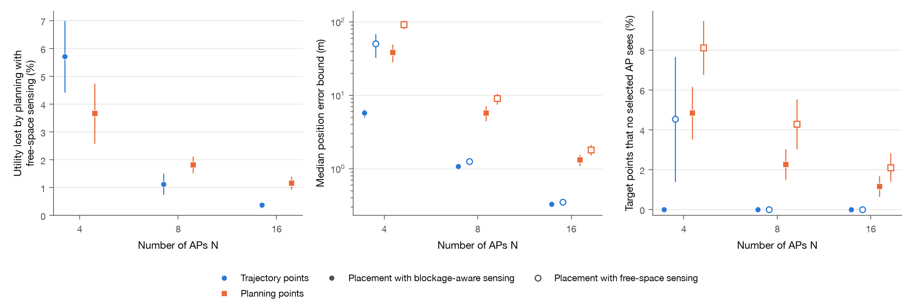</p>

<!-- results:begin -->
| Flight level (m) | Free cells (%) | Site-cell pairs in line of sight, free cells (%) | Site-cell pairs in line of sight, all cells (%) |
|---|---|---|---|
| 10 | 60.9 | 50.5 | 31.9 |
| 20 | 79.2 | 62.6 | 54.2 |
| 30 | 98.7 | 78.0 | 77.4 |
| 40 | 99.3 | 82.4 | 81.9 |
<!-- results:end -->

Line of sight is common above the roofs (median roof height 17.9 m) and scarce in the street
canyons. A second check concerns the simulator's database: all 847 radio maps were traced
again with Sionna RT 2.2.0.

<!-- results:begin -->
| `max_depth` | Radio maps compared | Identical blocked mask | Mean mask agreement | Smallest mask agreement | Mean absolute error (dB) | Largest absolute error (dB) |
|---|---|---|---|---|---|---|
| 3 | 847 | 716 | 0.99999 | 0.99898 | 0.0009 | 2.38 |
| 4 | 60 | 0 | 0.99881 | 0.99603 | 0.1015 | 3.34 |
<!-- results:end -->

The stored database is reproduced with a tracing depth of 3, not with the depth of 4 that
`simulation/generate_offline_database.py` sets on an attribute the solver does not read
([docs/implementation_notes.md](docs/implementation_notes.md)).

<!-- results:begin -->
| Target points | N | Utility lost (%) | Sensing value lost (%) | Gap, rate part | Gap, sensing part | PEB median (m), aware / free-space | PEB 90th percentile (m), aware / free-space | Points no selected AP sees (%), aware / free-space | Sites shared (%) |
|---|---|---|---|---|---|---|---|---|---|
| Trajectory | 4 | 5.72 [4.43, 7.01] | 21.8 [17.1, 26.5] | -0.0200 [-0.0257, -0.0143] | 0.0528 [0.0418, 0.0638] | 5.78 / 50.68 | 73.4 / 144.5 | 0.0 / 4.5 | 38 [31, 44] |
| Trajectory | 8 | 1.13 [0.75, 1.51] | 5.3 [4.0, 6.6] | -0.0089 [-0.0115, -0.0062] | 0.0167 [0.0126, 0.0208] | 1.09 / 1.25 | 9.7 / 56.1 | 0.0 / 0.0 | 64 [56, 71] |
| Trajectory | 16 | 0.38 [0.27, 0.49] | 1.9 [1.5, 2.4] | -0.0041 [-0.0052, -0.0031] | 0.0071 [0.0055, 0.0087] | 0.33 / 0.35 | 2.9 / 5.0 | 0.0 / 0.0 | 76 [72, 80] |
| Planning | 4 | 3.67 [2.59, 4.75] | 17.6 [13.5, 21.8] | -0.0136 [-0.0184, -0.0087] | 0.0329 [0.0253, 0.0406] | 38.95 / 92.44 | 130.2 / 147.6 | 4.8 / 8.1 | 49 [39, 58] |
| Planning | 8 | 1.83 [1.53, 2.13] | 9.1 [7.7, 10.5] | -0.0115 [-0.0142, -0.0088] | 0.0231 [0.0194, 0.0268] | 5.83 / 9.13 | 90.2 / 121.8 | 2.3 / 4.3 | 61 [55, 67] |
| Planning | 16 | 1.17 [0.94, 1.40] | 5.1 [4.2, 6.1] | -0.0077 [-0.0094, -0.0060] | 0.0163 [0.0132, 0.0193] | 1.32 / 1.81 | 18.3 / 47.0 | 1.2 / 2.1 | 68 [64, 73] |
<!-- results:end -->

Both placements are evaluated on the blockage-aware utility (best response, 20 scenarios).
Ignoring blockage costs 5.7% of the utility with 4 APs on the simulator's trajectories and
0.4% with 16; the loss is in the sensing part and is partly offset by a higher rate
(negative gap of the rate part). With 4 APs the placement that ignores blockage leaves 4.5%
of the trajectory points unseen and has a median position error bound of 50.68 m against
5.78 m. On the planning points, which include the level of 10 m, the losses are 3.7%, 1.8%
and 1.2%. The structure of the objective changes little (same estimators and sampled sets as
E1):

<!-- results:begin -->
| Set function | Sensing model, target points | Violating triples (%) | Submodularity ratio | Diminishing-return ratio | Curvature | Implied greedy factor | Implied equilibrium factor |
|---|---|---|---|---|---|---|---|
| Sensing, joint roles `L` | Free space, trajectory points (E1) | 0.79 [0.73, 0.85] | 0.903 | 0.722 | 0.980 | 0.599 | 0.320 |
| Sensing, joint roles `L` | Blockage-aware, trajectory points | 1.16 [1.08, 1.24] | 0.919 | 0.729 | 0.993 | 0.603 | 0.328 |
| Sensing, joint roles `L` | Blockage-aware, planning points | 0.81 [0.76, 0.87] | 0.927 | 0.802 | 0.967 | 0.612 | 0.374 |
| Team utility `U` (lam = 0.5) | Free space, trajectory points (E1) | 0.30 [0.22, 0.38] | 0.937 | 0.803 | 0.981 | 0.613 | 0.377 |
| Team utility `U` (lam = 0.5) | Blockage-aware, trajectory points | 0.37 [0.28, 0.47] | 0.949 | 0.689 | 0.993 | 0.615 | 0.310 |
| Team utility `U` (lam = 0.5) | Blockage-aware, planning points | 0.30 [0.23, 0.38] | 0.954 | 0.874 | 0.968 | 0.623 | 0.422 |
<!-- results:end -->

### E9: equilibria of the mode game (`results/e9_mode_equilibria.json`)

<p align="center">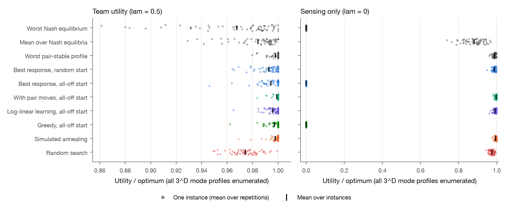</p>

<!-- results:begin -->
| Utility / optimum, with energy cost | lam = 0.5 (team utility) | lam = 0 (sensing only) | lam = 1 (sum rate only) |
|---|---|---|---|
| Worst Nash equilibrium | 0.9676 [0.9590, 0.9762], min 0.8613 | 0.0000 [0.0000, 0.0000], min 0.0000 | 1.0000 [0.9999, 1.0000], min 0.9988 |
| Mean over all Nash equilibria | 0.9842 [0.9799, 0.9885] | 0.8818 [0.8686, 0.8951] | 1.0000 [1.0000, 1.0000] |
| Worst pair-stable profile | 0.9980 [0.9968, 0.9991], min 0.9797 | 0.9882 [0.9861, 0.9903], min 0.9600 | 1.0000 [1.0000, 1.0000], min 1.0000 |
| Best response, one run (random start) | 0.9928 [0.9906, 0.9951], min 0.8959 | 0.9868 [0.9846, 0.9891], min 0.9219 | 1.0000 [0.9999, 1.0000], min 0.9988 |
| Best response, one run (all-off start) | 0.9944 [0.9919, 0.9968], min 0.9461 | 0.0000 [0.0000, 0.0000], min 0.0000 | 1.0000 [0.9999, 1.0000], min 0.9988 |
| Best response (restarts) | 0.9997 [0.9995, 0.9999], min 0.9893 | 0.9988 [0.9983, 0.9993], min 0.9857 | 1.0000 [1.0000, 1.0000], min 1.0000 |
| Best response with pair moves, one run (all-off start) | 0.9991 [0.9984, 0.9998], min 0.9836 | 0.9968 [0.9955, 0.9981], min 0.9795 | 1.0000 [1.0000, 1.0000], min 1.0000 |
| Best response with pair moves (restarts) | 0.9998 [0.9996, 0.9999], min 0.9907 | 0.9977 [0.9967, 0.9986], min 0.9654 | 1.0000 [1.0000, 1.0000], min 1.0000 |
| Log-linear learning, then best response (all-off start) | 0.9960 [0.9945, 0.9974], min 0.9475 | 0.9909 [0.9889, 0.9930], min 0.9471 | 1.0000 [1.0000, 1.0000], min 1.0000 |
| Greedy (all-off start) | 0.9971 [0.9955, 0.9987], min 0.9622 | 0.0000 [0.0000, 0.0000], min 0.0000 | 1.0000 [1.0000, 1.0000], min 0.9995 |
| Simulated annealing | 0.9978 [0.9965, 0.9992], min 0.9532 | 0.9944 [0.9931, 0.9958], min 0.9623 | 1.0000 [1.0000, 1.0000], min 0.9997 |
| Random search | 0.9742 [0.9714, 0.9770], min 0.9315 | 0.9751 [0.9721, 0.9780], min 0.9314 | 0.9758 [0.9728, 0.9787], min 0.9273 |
<!-- results:end -->

60 instances (8, 10 or 12 deployed APs); the optimum, all Nash equilibria and all
pair-stable profiles (no single AP and no two APs can improve) are found by enumerating the
`3^D` mode profiles; budgets of `60 D` evaluations. For the team utility the worst
equilibrium is on average 3.2% below the optimum (13.9% in the worst instance) and the
worst pair-stable profile 0.2% (2.0%). For sensing only, all APs off is an equilibrium in
every instance: a lone transmitter or receiver gains nothing. Best response and greedy
started from all-off stay there; best response with pair moves does not. Log-linear
learning also leaves it. A tuned simulated annealing (0.9978) is better than a single
best-response run (0.9928) and below best response with restarts at the same budget
(0.9997).

<!-- results:begin -->
| lam | Costs | Active APs at the optimum | Nash equilibria | Pair-stable profiles | Instances with an equilibrium without a pair (%) | Equilibria without a pair (%) | Pair-stable profiles without a pair (%) | Best response from all-off ends without a pair (%) | Greedy ends without a pair (%) | Best response with pair moves from all-off ends without a pair (%) |
|---|---|---|---|---|---|---|---|---|---|---|
| 0.5 | with energy cost | 8.85 [8.54, 9.16] | 4.10 [3.52, 4.68] | 1.33 [1.19, 1.48] | 0 [0, 0] | 0.0 [0.0, 0.0] | 0.0 [0.0, 0.0] | 0 | 0 | 0 |
| 0.5 | without energy cost | 9.95 [9.53, 10.37] | 4.37 [3.45, 5.29] | 1.32 [1.16, 1.47] | 0 [0, 0] | 0.0 [0.0, 0.0] | 0.0 [0.0, 0.0] | 0 | 0 | 0 |
| 0 | with energy cost | 8.08 [7.74, 8.43] | 13.35 [11.16, 15.54] | 2.83 [2.60, 3.06] | 100 [100, 100] | 10.1 [8.8, 11.5] | 0.0 [0.0, 0.0] | 100 | 100 | 0 |
| 0 | without energy cost | 9.48 [9.05, 9.92] | 27.63 [21.81, 33.46] | 7.57 [5.51, 9.62] | 100 [100, 100] | 10.0 [8.6, 11.3] | 0.0 [0.0, 0.0] | 100 | 100 | 0 |
<!-- results:end -->

### E10: online tracking (`results/e10_online_tracking.json`)

<p align="center">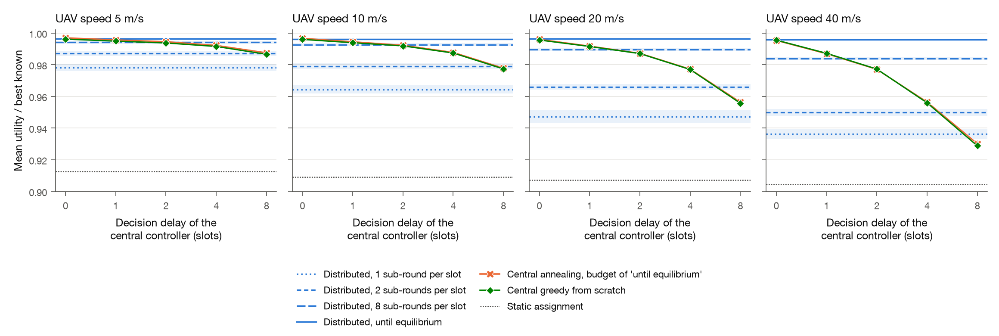</p>

<!-- results:begin -->
| Controller | Utility / best known | Tracking gain captured (%) | PEB median (m) | PEB 90th percentile (m) | Target-slots without a pair (%) | Sum rate (bit/s/Hz) | Active APs | Mode switches per slot | Evaluations per slot | Messages per slot |
|---|---|---|---|---|---|---|---|---|---|---|
| Reference (best response with pair moves, restarts, no delay) | 1.0000 [1.0000, 1.0000] | 100.0 [100.0, 100.0] | 1.59 [1.38, 1.80] | 8.1 [6.5, 9.7] | 0.04 [0.00, 0.09] | 129.4 [126.1, 132.7] | 11.6 | 1.42 | 8724 | 1.4 |
| Distributed, 1 sub-round per slot | 0.9644 [0.9618, 0.9670] | 58.2 [53.3, 63.1] | 1.98 [1.69, 2.27] | 12.3 [10.0, 14.6] | 0.08 [0.01, 0.15] | 129.2 [125.9, 132.5] | 12.7 | 0.26 | 3 | 5.9 |
| Distributed, 2 sub-rounds per slot | 0.9790 [0.9773, 0.9808] | 75.2 [71.7, 78.7] | 1.79 [1.56, 2.03] | 10.3 [8.4, 12.2] | 0.11 [0.01, 0.21] | 129.3 [125.9, 132.7] | 12.3 | 0.39 | 6 | 8.8 |
| Distributed, 8 sub-rounds per slot | 0.9927 [0.9917, 0.9937] | 91.5 [90.2, 92.8] | 1.66 [1.43, 1.88] | 8.7 [7.0, 10.5] | 0.04 [0.00, 0.10] | 129.3 [126.0, 132.6] | 11.8 | 0.63 | 25 | 14.3 |
| Distributed, until equilibrium | 0.9962 [0.9957, 0.9967] | 95.6 [94.9, 96.3] | 1.62 [1.41, 1.84] | 8.4 [6.7, 10.1] | 0.04 [0.00, 0.09] | 129.3 [126.0, 132.5] | 11.7 | 0.80 | 98 | 19.7 |
| Distributed, pair moves, until pair-stable | 0.9994 [0.9993, 0.9996] | 99.4 [99.2, 99.5] | 1.59 [1.38, 1.81] | 8.2 [6.6, 9.8] | 0.04 [0.00, 0.09] | 129.4 [126.0, 132.7] | 11.6 | 1.16 | 1423 | 684.3 |
| Central annealing, full budget, delay 0 | 0.9967 [0.9962, 0.9972] | 96.2 [95.6, 96.7] | 1.62 [1.41, 1.83] | 8.3 [6.7, 9.9] | 0.04 [0.00, 0.09] | 129.3 [126.0, 132.6] | 11.7 | 1.03 | 98 | 1.0 |
| Central annealing, full budget, delay 1 | 0.9945 [0.9939, 0.9951] | 93.6 [92.7, 94.5] | 1.65 [1.43, 1.86] | 8.7 [7.1, 10.4] | 0.05 [0.00, 0.11] | 129.3 [126.0, 132.6] | 11.7 | 1.03 | 98 | 1.0 |
| Central annealing, full budget, delay 2 | 0.9923 [0.9915, 0.9932] | 91.0 [89.7, 92.3] | 1.69 [1.47, 1.90] | 9.2 [7.4, 10.9] | 0.08 [0.00, 0.18] | 129.3 [126.0, 132.6] | 11.7 | 1.02 | 98 | 1.0 |
| Central annealing, full budget, delay 4 | 0.9878 [0.9867, 0.9889] | 85.6 [83.6, 87.6] | 1.77 [1.55, 1.99] | 10.0 [8.1, 11.9] | 0.13 [0.00, 0.27] | 129.3 [126.0, 132.6] | 11.7 | 1.02 | 98 | 1.0 |
| Central annealing, full budget, delay 8 | 0.9779 [0.9763, 0.9794] | 73.9 [70.4, 77.3] | 1.98 [1.74, 2.22] | 12.4 [10.2, 14.5] | 0.21 [0.07, 0.36] | 129.3 [126.0, 132.6] | 11.7 | 1.00 | 98 | 1.0 |
| Central greedy from scratch, delay 0 | 0.9960 [0.9955, 0.9965] | 95.3 [94.4, 96.2] | 1.66 [1.43, 1.88] | 8.5 [6.8, 10.2] | 0.19 [0.00, 0.39] | 129.1 [125.8, 132.3] | 11.5 | 2.11 | 649 | 2.1 |
| Periodic re-optimisation (reference solver) | 0.9753 [0.9732, 0.9775] | 70.7 [66.3, 75.2] | 2.08 [1.80, 2.35] | 13.0 [10.9, 15.1] | 0.08 [0.00, 0.16] | 129.4 [126.1, 132.7] | 11.6 | 0.34 | 404 | 0.3 |
| Static assignment (optimised at slot 0) | 0.9091 [0.8962, 0.9221] | 0.0 [0.0, 0.0] | 4.06 [3.16, 4.95] | 40.4 [29.2, 51.7] | 0.82 [0.19, 1.45] | 129.0 [125.4, 132.7] | 11.7 | 0.00 | 0 | 0.0 |
<!-- results:end -->

24 planned APs, 240 slots, 20 scenarios. All controllers start from the reference solution
of slot 0; "best known" is, per slot, the best utility of any controller; the tracking gain
captured is 0% for the static assignment and 100% for the best known. The interaction graph
needs 23.1 colours for 24 APs, so one sub-round moves about one AP and "until equilibrium"
means 31.6 sub-rounds per slot.

<!-- results:begin -->
| Speed (m/s) | Distributed, until equilibrium | Central, delay 0 | Central, delay 1 | Central, delay 2 | Central, delay 4 | Central, delay 8 | Static |
|---|---|---|---|---|---|---|---|
| 5 | 0.9963 [0.9956, 0.9970] | 0.9970 [0.9965, 0.9975] | 0.9957 [0.9951, 0.9963] | 0.9946 [0.9938, 0.9953] | 0.9922 [0.9912, 0.9933] | 0.9875 [0.9860, 0.9891] | 0.9127 [0.8987, 0.9267] |
| 10 | 0.9962 [0.9957, 0.9967] | 0.9967 [0.9962, 0.9972] | 0.9945 [0.9939, 0.9951] | 0.9923 [0.9915, 0.9932] | 0.9878 [0.9867, 0.9889] | 0.9779 [0.9763, 0.9794] | 0.9091 [0.8962, 0.9221] |
| 20 | 0.9963 [0.9957, 0.9969] | 0.9960 [0.9956, 0.9965] | 0.9918 [0.9913, 0.9923] | 0.9872 [0.9865, 0.9879] | 0.9772 [0.9761, 0.9783] | 0.9564 [0.9543, 0.9584] | 0.9072 [0.8976, 0.9168] |
| 40 | 0.9959 [0.9954, 0.9965] | 0.9954 [0.9950, 0.9957] | 0.9870 [0.9864, 0.9875] | 0.9771 [0.9763, 0.9779] | 0.9565 [0.9550, 0.9579] | 0.9302 [0.9280, 0.9323] | 0.9045 [0.8948, 0.9143] |
<!-- results:end -->

With no delay, central annealing with the evaluations of the converged distributed
controller has the same utility (within 0.001 of the best known at every speed). The first
slot of delay costs it 0.0013 of the best known utility at 5 m/s, 0.0022 at 10 m/s, 0.0042
at 20 m/s and 0.0084 at 40 m/s. The rate is the same for all controllers (129 bit/s/Hz);
what is lost is sensing: the 90th percentile of the position
error bound grows from 8.3 m (no delay) to 12.4 m (8 slots) at 10 m/s, and to 40.4 m for the
static assignment.

<!-- results:begin -->
| Speed (m/s) | Distributed controller | Matched budget: first delay behind | Full budget: first delay behind | Full budget: largest delay still ahead |
|---|---|---|---|---|
| 5 | Distributed, 1 sub-round per slot | 0 | not up to 8 | 8 |
| 5 | Distributed, 2 sub-rounds per slot | 0 | not up to 8 | 4 |
| 5 | Distributed, 8 sub-rounds per slot | 1 | 4 | 1 |
| 5 | Distributed, until equilibrium | 1 | 1 | 0 |
| 10 | Distributed, 1 sub-round per slot | 2 | not up to 8 | 8 |
| 10 | Distributed, 2 sub-rounds per slot | 1 | not up to 8 | 4 |
| 10 | Distributed, 8 sub-rounds per slot | 1 | 4 | 1 |
| 10 | Distributed, until equilibrium | 1 | 1 | at no delay |
| 20 | Distributed, 1 sub-round per slot | 2 | not up to 8 | 8 |
| 20 | Distributed, 2 sub-rounds per slot | 1 | 8 | 4 |
| 20 | Distributed, 8 sub-rounds per slot | 0 | 2 | 1 |
| 20 | Distributed, until equilibrium | 1 | 1 | at no delay |
| 40 | Distributed, 1 sub-round per slot | 2 | 8 | 4 |
| 40 | Distributed, 2 sub-rounds per slot | 2 | 8 | 4 |
| 40 | Distributed, 8 sub-rounds per slot | 1 | 2 | 1 |
| 40 | Distributed, until equilibrium | 0 | 0 | at no delay |
<!-- results:end -->

"Behind" and "ahead" are statements about the paired difference to the distributed
controller in the same scenarios (95% interval excludes 0). Against the converged
distributed controller, central control is behind from a delay of one slot (at 40 m/s
already without delay). Against a distributed controller that can only do one or two
sub-rounds per slot, a central controller with the full budget is ahead with 4 slots (2 s)
of delay at every speed, and with 8 slots up to 20 m/s (one sub-round).

<p align="center">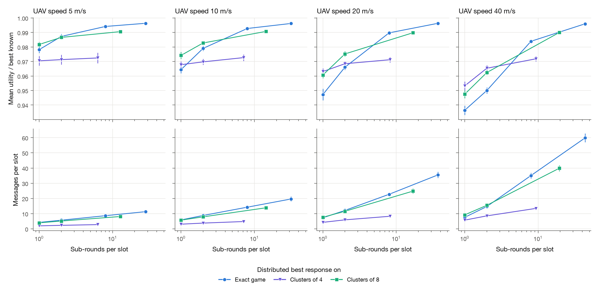</p>

Restricting every user and UAV to its 4 or 8 strongest APs gives a game with about 5 and
10 colours, in which a sub-round moves several APs. With one sub-round per slot the
clustered controllers are better than the exact one from 10 m/s on (0.9678 for clusters of 4
against 0.9644 at 10 m/s, 0.9532 against 0.9364 at 40 m/s), and the clusters of 4 send fewer
messages; run until equilibrium they end 0.6% (clusters of 8) and 2.4% (clusters of 4) below
the exact controller run until equilibrium (`results/tables.md`, section E10).

<!-- results:begin -->
| Deployment, controller | Utility (normalisers of the planned deployment) | Sum rate (bit/s/Hz) | PEB median (m) | PEB 90th percentile (m) | Target-slots without a pair (%) | Active APs | Utility / best known of the same deployment |
|---|---|---|---|---|---|---|---|
| Planned, reference | 0.7390 [0.7310, 0.7470] | 129.4 [126.1, 132.7] | 1.59 [1.38, 1.80] | 8.1 [6.5, 9.7] | 0.04 [0.00, 0.09] | 11.6 | 1.0000 [1.0000, 1.0000] |
| Planned, distributed, until equilibrium | 0.7362 [0.7282, 0.7442] | 129.3 [126.0, 132.5] | 1.62 [1.41, 1.84] | 8.4 [6.7, 10.1] | 0.04 [0.00, 0.09] | 11.7 | 0.9962 [0.9957, 0.9967] |
| Planned, static assignment | 0.6718 [0.6603, 0.6834] | 129.0 [125.4, 132.7] | 4.06 [3.16, 4.95] | 40.4 [29.2, 51.7] | 0.82 [0.19, 1.45] | 11.7 | 0.9091 [0.8962, 0.9221] |
| Random, reference | 0.6309 [0.6130, 0.6488] | 94.4 [88.9, 99.9] | 1.56 [1.29, 1.83] | 18.1 [12.4, 23.8] | 0.10 [0.00, 0.25] | 10.4 | 1.0000 [1.0000, 1.0000] |
| Random, distributed, until equilibrium | 0.6285 [0.6105, 0.6465] | 94.3 [88.8, 99.9] | 1.60 [1.32, 1.87] | 18.2 [12.7, 23.7] | 0.13 [0.00, 0.31] | 10.4 | 0.9961 [0.9954, 0.9969] |
| Random, static assignment | 0.5682 [0.5427, 0.5937] | 93.6 [87.8, 99.4] | 7.19 [1.06, 13.32] | 44.5 [29.4, 59.7] | 1.24 [0.18, 2.31] | 10.3 | 0.8996 [0.8757, 0.9236] |
<!-- results:end -->

Planning the deployment matters for operation: with the same controller the planned
deployment has 37% more sum rate than a random one and half the 90th percentile of the
position error bound; the median bound is the same.

### E11: locality and scaling (`results/e11_locality.json`)

<p align="center">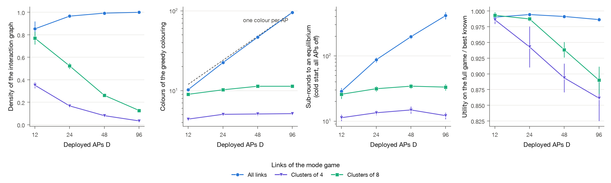</p>

<!-- results:begin -->
| D | Links kept | Users / UAVs | Density of the graph | Mean degree | Colours (greedy colouring) | Clique found | Share of the user and target terms an AP touches (%) |
|---|---|---|---|---|---|---|---|
| 12 | all links | 8 / 2 | 0.853 [0.787, 0.919] | 9.4 [8.7, 10.1] | 10.3 [9.8, 10.8] | 10.3 [9.8, 10.8] | 42.5 [38.0, 47.0] |
| 12 | clusters of 4 | 8 / 2 | 0.352 [0.325, 0.378] | 3.9 [3.6, 4.2] | 4.4 [4.2, 4.6] | 4.2 [4.0, 4.5] | 26.7 [25.3, 28.0] |
| 12 | clusters of 8 | 8 / 2 | 0.770 [0.713, 0.826] | 8.5 [7.8, 9.1] | 9.0 [8.5, 9.5] | 9.0 [8.5, 9.5] | 39.0 [35.4, 42.6] |
| 24 | all links | 15 / 4 | 0.966 [0.951, 0.980] | 22.2 [21.9, 22.5] | 22.4 [21.9, 23.0] | 22.4 [21.9, 23.0] | 43.7 [40.8, 46.6] |
| 24 | clusters of 4 | 15 / 4 | 0.168 [0.157, 0.178] | 3.9 [3.6, 4.1] | 5.0 [4.8, 5.3] | 4.2 [4.0, 4.5] | 15.1 [14.8, 15.4] |
| 24 | clusters of 8 | 15 / 4 | 0.523 [0.497, 0.550] | 12.0 [11.4, 12.6] | 10.2 [9.9, 10.6] | 9.2 [8.8, 9.6] | 26.2 [25.4, 27.1] |
| 48 | all links | 30 / 8 | 0.993 [0.988, 0.997] | 46.7 [46.4, 46.9] | 46.8 [46.2, 47.3] | 46.7 [46.1, 47.3] | 43.0 [40.8, 45.1] |
| 48 | clusters of 4 | 30 / 8 | 0.081 [0.078, 0.084] | 3.8 [3.6, 4.0] | 5.1 [4.8, 5.4] | 4.3 [4.0, 4.7] | 7.7 [7.6, 7.8] |
| 48 | clusters of 8 | 30 / 8 | 0.262 [0.250, 0.273] | 12.3 [11.8, 12.8] | 11.3 [11.0, 11.7] | 8.7 [8.3, 9.1] | 14.4 [14.1, 14.7] |
| 96 | all links | 60 / 16 | 1.000 [1.000, 1.000] | 95.0 [95.0, 95.0] | 95.7 [95.5, 95.9] | 95.7 [95.5, 95.9] | 43.6 [42.4, 44.9] |
| 96 | clusters of 4 | 60 / 16 | 0.034 [0.033, 0.035] | 3.3 [3.2, 3.3] | 5.2 [4.9, 5.4] | 4.2 [4.0, 4.3] | 3.9 [3.8, 3.9] |
| 96 | clusters of 8 | 60 / 16 | 0.127 [0.124, 0.130] | 12.1 [11.8, 12.4] | 11.3 [11.0, 11.7] | 8.9 [8.4, 9.5] | 7.4 [7.3, 7.5] |
<!-- results:end -->

Static snapshots; the load grows with the deployment (15 D / 24 users, D / 6 UAVs). The
interaction graph of the exact game is almost complete at every size, because most APs see
the same UAVs (78.0% and 82.4% of the site-cell pairs are in line of sight at 30 and 40 m).
The mean number of colours is within 0.1 of the mean size of the largest clique found, so
no colouring can do much better: best response on the colouring needs about as many
sub-rounds as a sequential sweep.

<!-- results:begin -->
| D | Active APs (best known) | Mode changes | Evaluations | Sub-rounds on the colouring | Cycles of colours | Terms recomputed per step: local / all |
|---|---|---|---|---|---|---|
| 12 | 8.2 [7.4, 8.9] | 13.3 [12.0, 14.7] | 101 [92, 110] | 29 [25, 32] | 2.77 [2.52, 3.03] | 9.5 / 30 |
| 24 | 11.7 [11.3, 12.1] | 30.5 [28.2, 32.8] | 283 [257, 308] | 87 [79, 95] | 3.87 [3.56, 4.19] | 19.2 / 57 |
| 48 | 13.2 [12.9, 13.6] | 47.4 [44.7, 50.1] | 595 [552, 638] | 197 [183, 211] | 4.21 [3.91, 4.50] | 37.8 / 114 |
| 96 | 13.2 [12.7, 13.8] | 57.1 [54.2, 60.1] | 1259 [1098, 1421] | 414 [363, 466] | 4.33 [3.79, 4.86] | 77.3 / 228 |
<!-- results:end -->

<!-- results:begin -->
| D | Best response: final / best known | Best response: reach 99% (%) | Best response: evaluations to 99% | Greedy: final / best known | Greedy: reach 99% (%) | Greedy: evaluations to 99% | Simulated annealing: final / best known | Simulated annealing: reach 99% (%) | Simulated annealing: evaluations to 99% |
|---|---|---|---|---|---|---|---|---|---|
| 12 | 0.9939 [0.9880, 0.9998] | 85 | 56 [49, 63] | 0.9960 [0.9927, 0.9993] | 85 | 181 [168, 194] | 0.9979 [0.9956, 1.0001] | 90 | 168 [95, 242] |
| 24 | 0.9950 [0.9929, 0.9972] | 95 | 156 [135, 178] | 0.9946 [0.9911, 0.9981] | 90 | 539 [503, 574] | 0.9990 [0.9982, 0.9999] | 100 | 407 [300, 515] |
| 48 | 0.9919 [0.9889, 0.9949] | 65 | 347 [292, 403] | 0.9935 [0.9912, 0.9959] | 80 | 1314 [1188, 1440] | 0.9929 [0.9892, 0.9966] | 75 | 897 [746, 1048] |
| 96 | 0.9872 [0.9839, 0.9905] | 45 | 904 [665, 1143] | 0.9899 [0.9880, 0.9919] | 45 | 2581 [2234, 2928] | 0.9897 [0.9871, 0.9923] | 60 | 3507 [3072, 3941] |
<!-- results:end -->

From a cold start, best response reaches 99% of the best known utility with the fewest
evaluations but ends lower than a simulated annealing whose schedule is tuned for each size;
for 48 and 96 APs none of the three reaches 99% reliably, and the reference solver with
pair moves is better (`figures/e11_evaluations.png`).

<!-- results:begin -->
| D | L | Colours | Sub-rounds to equilibrium | Full utility / best known | Active APs | After best response on the full game | Mode changes of that step |
|---|---|---|---|---|---|---|---|
| 12 | 4 | 4.4 [4.2, 4.6] | 11.3 [10.1, 12.5] | 0.9861 [0.9793, 0.9930] | 8.1 [7.4, 8.7] | 0.9931 [0.9882, 0.9980] | 1.1 [0.4, 1.7] |
| 12 | 8 | 9.0 [8.5, 9.5] | 25.9 [22.0, 29.7] | 0.9932 [0.9884, 0.9980] | 8.4 [7.6, 9.2] | 0.9940 [0.9893, 0.9988] | 0.2 [-0.1, 0.6] |
| 24 | 4 | 5.0 [4.8, 5.3] | 13.4 [12.3, 14.6] | 0.9429 [0.9101, 0.9757] | 12.6 [11.4, 13.8] | 0.9940 [0.9913, 0.9967] | 6.3 [4.1, 8.6] |
| 24 | 8 | 10.2 [9.9, 10.6] | 31.4 [28.6, 34.2] | 0.9874 [0.9839, 0.9910] | 12.5 [12.0, 13.0] | 0.9936 [0.9916, 0.9956] | 1.9 [1.1, 2.6] |
| 48 | 4 | 5.1 [4.8, 5.4] | 14.8 [13.0, 16.7] | 0.8936 [0.8707, 0.9165] | 15.8 [13.7, 18.0] | 0.9912 [0.9887, 0.9936] | 17.2 [14.5, 19.9] |
| 48 | 8 | 11.3 [11.0, 11.7] | 34.4 [31.4, 37.3] | 0.9384 [0.9259, 0.9510] | 17.3 [16.3, 18.3] | 0.9868 [0.9816, 0.9919] | 10.2 [8.1, 12.4] |
| 96 | 4 | 5.2 [4.9, 5.4] | 12.2 [10.8, 13.5] | 0.8614 [0.8250, 0.8979] | 10.3 [8.9, 11.8] | 0.9874 [0.9842, 0.9906] | 21.4 [19.1, 23.8] |
| 96 | 8 | 11.3 [11.0, 11.7] | 33.2 [29.6, 36.9] | 0.8900 [0.8683, 0.9117] | 15.9 [13.3, 18.6] | 0.9882 [0.9847, 0.9917] | 21.4 [18.4, 24.3] |
<!-- results:end -->

Clustering restores sparsity (4 to 5 and 9 to 11 colours at every size, 11 to 34 sub-rounds
to an equilibrium) at a price that grows with the deployment: evaluated on the full utility,
the clustered equilibria reach 0.94 and 0.99 of the best known for 24 APs and 0.86 and 0.89
for 96. Best response on the full game from there recovers 0.99 with fewer mode changes
than from a cold start.

### E12: failures (`results/e12_failures.json`)

<p align="center">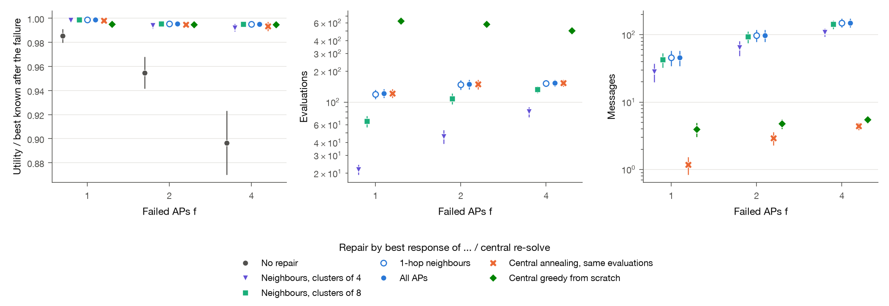</p>

<!-- results:begin -->
| State | Utility / best known after the failure | Utility / utility before the failure | PEB (m) | Active APs | APs allowed to move | APs that changed mode | Evaluations | Messages |
|---|---|---|---|---|---|---|---|---|
| Before the failure | - | 1.0000 [1.0000, 1.0000] | 7.39 [1.77, 13.01] | 11.7 [11.2, 12.1] | - | - | - | - |
| After the failure, no repair | 0.8966 [0.8700, 0.9233] | 0.8400 [0.8081, 0.8718] | 32.39 [19.55, 45.23] | 7.7 [7.2, 8.1] | 0.0 | 0.00 | 0 | 0.0 |
| Best response of the 1-hop neighbours of the failed APs | 0.9952 [0.9935, 0.9969] | 0.9314 [0.9201, 0.9428] | 12.92 [5.01, 20.83] | 10.7 [10.3, 11.1] | 19.9 | 4.18 | 153 | 150.7 |
| Best response of the 2-hop neighbours | 0.9952 [0.9935, 0.9969] | 0.9314 [0.9201, 0.9428] | 12.92 [5.01, 20.83] | 10.7 [10.3, 11.1] | 19.9 | 4.18 | 153 | 150.7 |
| Best response of the neighbours in the graph of clusters of 4 | 0.9922 [0.9891, 0.9953] | 0.9287 [0.9154, 0.9419] | 14.92 [6.25, 23.59] | 10.4 [10.0, 10.9] | 10.9 | 3.43 | 80 | 109.3 |
| Best response of the neighbours in the graph of clusters of 8 | 0.9950 [0.9933, 0.9967] | 0.9312 [0.9198, 0.9426] | 13.26 [5.21, 21.31] | 10.7 [10.3, 11.1] | 17.6 | 4.12 | 133 | 142.8 |
| Best response of all APs | 0.9952 [0.9935, 0.9969] | 0.9314 [0.9201, 0.9428] | 12.92 [5.01, 20.83] | 10.7 [10.3, 11.1] | 20.0 | 4.18 | 154 | 150.7 |
| Central annealing, evaluations of the row above | 0.9933 [0.9894, 0.9972] | 0.9297 [0.9165, 0.9430] | 13.39 [5.45, 21.32] | 10.8 [10.4, 11.2] | 20.0 | 4.40 | 154 | 4.4 |
| Central greedy from scratch | 0.9948 [0.9917, 0.9978] | 0.9311 [0.9192, 0.9429] | 13.81 [5.60, 22.01] | 10.6 [10.2, 11.1] | 20.0 | 5.52 | 503 | 5.5 |
<!-- results:end -->

24 APs at the reference equilibrium; 1, 2 or 4 active APs fail (the table shows 4; 20
scenarios, 3 draws each). Without repair the utility falls to 0.985, 0.955 and 0.897 of the
best known after the failure. Best response of the surviving APs restores 0.999, 0.996 and
0.995 with 122 to 154 evaluations and changes 1.1 to 4.2 APs. Because the graph is dense,
the 1-hop neighbourhood of the failed APs is almost the whole network; the neighbours in
the graph of clusters of 4 (4.5 to 10.9 APs) reach 0.998, 0.994 and 0.992 with 22 to 80
evaluations. Central annealing started from the surviving profile with the same evaluations
is within 0.002 of full best response and needs 1.2 to 4.4 commands instead of 46 to 151
messages; greedy from scratch needs 503 to 629 evaluations and changes more APs.

### Where the multi-agent formulation helps in operation and where it does not

* **Helps: no central round trip.** A distributed controller that converges within a slot
  keeps 0.996 of the best known utility at every speed from 5 to 40 m/s. Central annealing
  with the same evaluations matches it only without delay and is behind once its decisions
  are one slot (0.5 s) old. This is a latency advantage, not a better optimiser.
* **Helps: certificates and one repaired failure mode.** Every run ends in an equilibrium
  (Proposition 6); an AP needs only the aggregates of its users and targets (Proposition
  7). Pair moves remove the all-off trap of the sensing-only game, in which best response
  and the central greedy both stay at utility 0.
* **Helps: repair without a global re-solve.** After failures, best response from the
  surviving profile restores 0.995 to 0.999 of the best known and changes few APs; greedy
  from scratch costs three to five times the evaluations.
* **Does not help: locality.** The interaction graph is almost complete (density 0.97 for
  24 APs, 1.00 for 96), the colouring gives no parallelism, and convergence needs 28 to 44
  sequential sub-rounds per slot. With one or two sub-rounds per slot the distributed
  controller captures 58% and 75% of the tracking gain at 10 m/s, and a central controller
  with 4 slots of delay is better.
* **Does not help: messages.** The distributed controller sends 19.7 messages per slot at
  10 m/s (59.8 at 40 m/s), the central one 1.0 commands (2.8), because every mode change is
  announced to about 23 neighbours.
* **Does not help: solution quality.** With no delay and equal evaluations central
  annealing is as good; from a cold start a tuned annealing ends higher than one
  best-response run (0.9990 against 0.9950 for 24 APs); warm-started annealing repairs
  failures as well as best response.
* **Mixed: clustering.** Restricting users and UAVs to their strongest APs buys the
  parallelism that the exact game lacks and wins when very few sub-rounds fit into a slot,
  but it converges to worse profiles and its cost grows with the deployment.
* **Scope.** One scene; UAVs at 10 to 40 m, where most APs have line of sight; binary
  blockage with free-space gains; target positions known exactly and without delay to
  whoever decides; static users; a slot and sub-round timing model instead of a protocol.
  Limitations: [docs/notes.md](docs/notes.md), Section 10.

## Method-to-code map

| Item | Code |
|---|---|
| Path-gain database, valid sites, encoding | `src/cfisac_ma/data.py`: `load_scene`, `encode_path_gain`, `decode_path_gain` |
| Users, targets, hotspot changes | `src/cfisac_ma/scenario.py`: `draw_users`, `target_points`, `draw_hotspots`, `make_problem` |
| Rates, information matrices, `log det`, utility, normalisation | `src/cfisac_ma/objective.py`: `Problem.components`, `Problem.utility`, `Problem.utility_replace`, `Problem.fim` |
| Counting of objective evaluations, best-so-far traces | `objective.py`: `Evaluator` |
| Proposition 1, exact asynchronous best response | `src/cfisac_ma/team.py`: `best_response_dynamics` |
| Proposition 2, difference utilities | `team.py`: `best_response_dynamics(reward="difference")`, `bandit_learning(reward="difference")`; `objective.py`: `Evaluator.without` |
| Sampled best response | `team.py`: `sampled_best_response` |
| Bandit (policy-gradient) learners | `team.py`: `bandit_learning` |
| Best response on a surrogate potential (max-min variant) | `team.py`: `two_phase_best_response`; `objective.py`: rate mode `"saturated"` |
| Greedy, simulated annealing, genetic algorithm, random search | `src/cfisac_ma/centralized.py`: `greedy`, `simulated_annealing`, `genetic_algorithm`, `random_search` |
| Exhaustive search, all pure Nash equilibria | `centralized.py`: `exhaustive_terms`, `exhaustive_values`, `nash_equilibria` |
| Submodularity violations, submodularity ratio, diminishing-return ratio, curvature | `src/cfisac_ma/structure.py`: `estimate_structure`, `set_functions` |
| Statistical channels and the log-distance fit | `scenario.py`: `fit_log_distance`, `model_snr` |
| Experiments E1-E7, settings of the two passes | `src/cfisac_ma/experiments.py`: `run_e1` ... `run_e7`, `PASSES` |
| Confidence intervals | `src/cfisac_ma/stats.py`: `mean_ci` |
| Figures | `src/cfisac_ma/plotting.py` |
| Propositions 1-5, numerical checks | `tests/test_propositions.py` |
| Line-of-sight tables, visibility lookup, free cells | `src/cfisac_ma/aerial.py`: `load_aerial_los`, `AerialLos.visible`, `AerialLos.is_free` |
| Blockage-aware sensing in the placement problem | `scenario.py`: `make_problem(..., blockage=...)` |
| Planning points, random-waypoint UAV paths | `aerial.py`: `planning_points`, `waypoint_path`, `target_tracks` |
| Physical scale of the information matrix, position error bound | `aerial.py`: `sensing_scale`, `processing_gain_db_for_scale`, `position_error_bound` |
| Mode-selection game: utility, parts, normalisers | `src/cfisac_ma/operation.py`: `ModeProblem.utility`, `ModeProblem.terms` |
| Incremental evaluation of single and pair mode changes; the local form of Proposition 7 | `operation.py`: `ModeProblem.deviations`, `ModeProblem.pair_deviations`, `ModeProblem.local_gain` |
| Interaction graph, colouring, clusters of the strongest APs, failed APs | `operation.py`: `ModeProblem.interaction_graph`, `greedy_colouring`, `clique_lower_bound`, `ModeProblem.clustered`, `ModeProblem.without` |
| Proposition 6, sequential best response | `operation.py`: `best_response` |
| Proposition 8, best response on a colouring | `operation.py`: `coloured_best_response` |
| Proposition 9, pair moves; log-linear learning | `operation.py`: `pair_best_response`, `pair_gain_bound`, `log_linear_learning` |
| Central methods on mode profiles | `operation.py`: `greedy`, `simulated_annealing`, `random_search`, `reference_solve` |
| Exhaustive search, all Nash equilibria and pair-stable profiles | `operation.py`: `exhaustive_terms`, `utility_from_terms`, `equilibrium_masks` |
| Episodes and online controllers, decision delay, message count | `operation.py`: `Episode`, `run_distributed`, `run_annealing`, `run_greedy`, `run_reference`, `delayed`, `command_messages` |
| Deployments, scenarios, experiments E8-E12, calibration and tuning, settings of the two passes | `src/cfisac_ma/experiments_op.py`: `deploy`, `make_episode`, `run_e8` ... `run_e12`, `run_tuning`, `PASSES` |
| Figures of the operation study | `src/cfisac_ma/plotting_op.py` |
| Propositions 6-9, physical scale, numerical checks | `tests/test_propositions_op.py`, `tests/test_aerial.py`, `tests/test_operation.py` |
| Exact line-of-sight tests and re-tracing of the database with Sionna RT | `scripts/raytrace_scene.py` |
| Ray tracing of the radio maps | `simulation/generate_offline_database.py`, `simulation/main.py` |
| Single-agent deployment environment, SAC, simulated annealing and genetic algorithm of the simulator | `simulation/isac_env.py`, `simulation/train.py`, `simulation/compare_baselines.py` |

## Repository structure

```text
.
├── simulation/            # the ray-traced simulator: scripts and their .npy arrays
│   ├── generate_offline_database.py, main.py      # Sionna RT radio maps
│   ├── isac_env.py, train.py, compare_baselines.py, test_env.py
│   ├── main_app.py, preview_model.py, view_heatmap.py, render_topdown.py, check_database.py
│   └── paris_pg_database_3d.npy, candidate_positions_3d.npy, drl_real_curve.npy, ...
├── scenes/                # scene.xml, buildings.ply, ground.ply
├── src/cfisac_ma/
│   ├── data.py            # compact database: encode, decode, load, valid sites
│   ├── scenario.py        # users, targets, sensing geometry, statistical channels
│   ├── objective.py       # Problem (rates, FIM, utility) and Evaluator (evaluation counter)
│   ├── team.py            # best response, sampled best response, bandit learners
│   ├── centralized.py     # greedy, SA, GA, random search, exhaustive search, equilibria
│   ├── structure.py       # submodularity ratio, curvature, violation rates
│   ├── experiments.py     # E1-E7 and their settings
│   ├── aerial.py          # line-of-sight tables, planning points, UAV paths, physical scale
│   ├── operation.py       # mode-selection game, distributed and central methods, controllers
│   ├── experiments_op.py  # E8-E12, calibration and tuning, their settings
│   ├── runner.py          # command-line entry point, JSON and CSV output
│   ├── plotting.py        # figures of E1-E7
│   ├── plotting_op.py     # figures of E8-E12
│   └── stats.py           # Student-t intervals
├── scripts/
│   ├── reproduce_all.py   # everything with one command (--suite placement|operation|all)
│   ├── run_e1_structure.py ... run_e7_channel_model.py
│   ├── run_e8_blockage.py ... run_e12_failures.py
│   ├── tune_baselines.py, tune_operation.py, make_figures.py, make_tables.py
│   ├── build_database.py  # derives data/ from the arrays in simulation/
│   ├── raytrace_scene.py  # line-of-sight tables, database and lookup checks (needs Sionna RT)
│   └── quickstart.py
├── data/                  # compact database, candidate positions, line-of-sight tables, manifests, README
├── results/               # JSON and CSV of E1-E12, tables.md, tuning files, runtime files
│   ├── pass1/             # results of the first pass of E1-E7
│   └── operation_pass1/   # results of the first pass of E8-E12
├── figures/               # PNG, 200 dpi
├── docs/
│   ├── theory.md          # propositions 1-9, proofs, numerical evidence
│   ├── notes.md           # assumptions, what was run, the two passes, limitations (both studies)
│   ├── frontier.md        # literature survey: open directions and positioning
│   ├── implementation_notes.md   # notes on the simulator code, its release, the database check
│   └── figures/           # sample outputs of the simulator, roof-height map
├── tests/                 # offline tests: propositions, algorithms, data, operation, simulator environment
├── .github/workflows/ci.yml
├── pyproject.toml, requirements.txt
└── LICENSE
```

## Related work

**AP placement and sensing-aware deployment.** Placement for rate alone is commonly treated
with vector quantisation ([Gopal and Rao, 2022](https://arxiv.org/abs/2211.13356)).
Sensing-aware formulations include a single soft actor-critic agent with a rate and
D-optimality objective on a statistical channel
([Xu et al., 2024](https://arxiv.org/abs/2412.07094), the formulation this study starts
from), ADMM placement that minimises localisation and velocity Cramér-Rao bounds
([Liu et al., 2025](https://arxiv.org/abs/2506.23473)), area-CRLB base-station deployment
for cellular ISAC ([Meng et al., 2025](https://arxiv.org/abs/2506.18009)) and AP role
selection under sensing constraints ([Yan et al., 2024](https://arxiv.org/abs/2412.02649)).

**Multi-agent learning and credit assignment.** In cell-free networks multi-agent
reinforcement learning is mostly used for fast-timescale control
([Liu et al., 2023](https://arxiv.org/abs/2307.02827);
[Wang et al., 2026](https://arxiv.org/abs/2604.09981)); positions become actions for mobile
or UAV-mounted APs ([Liu et al., 2024](https://arxiv.org/abs/2412.02581);
[Wang et al., 2026](https://arxiv.org/abs/2609.23992)). The credit-assignment ideas used
here are counterfactual baselines
([Foerster et al., 2018](https://arxiv.org/abs/1705.08926)) and difference rewards computed
from a known reward function ([Castellini et al., 2022](https://arxiv.org/abs/2012.11258)).

**Ray-traced digital twins.** The scene comes from Sionna RT
([Hoydis et al., 2023](https://arxiv.org/abs/2303.11103)). Learning-based siting has used a
learned path-loss predictor ([Lee and Molisch, 2025](https://arxiv.org/abs/2502.19647)) or
ray-traced data for one additional base station
([Al-Tahmeesschi et al., 2024](https://arxiv.org/abs/2404.14954)); submodular greedy site
selection on Sionna RT maps exists for a communication surrogate
([Taus et al., 2026](https://arxiv.org/abs/2604.28153)); and
[Almohamad et al., 2026](https://arxiv.org/abs/2609.11121) report that placement policies
trained on analytical channels can stay near-optimal on ray-traced maps, which experiment
E7 checks for this scene.

**Submodular and game-theoretic placement.** Greedy guarantees for submodular sensor
placement ([Krause et al., 2008](https://jmlr.org/papers/v9/krause08a.html)) and their
extension to non-submodular objectives through the submodularity ratio and curvature
([Bian et al., 2017](https://proceedings.mlr.press/v70/bian17a.html)); submodular D-optimal
beacon placement ([Sequeira et al., 2024](https://arxiv.org/abs/2405.11550)); the factor-two
bound for equilibria of valid utility games
([Vetta, 2002](https://ieeexplore.ieee.org/document/1181966)); potential-game formulations
of cooperative control
([Marden et al., 2009](https://ieeexplore.ieee.org/document/4814554)); base-station
location games ([Mériaux et al., 2011](https://arxiv.org/abs/1105.2243)) and potential-game
UAV deployment ([Tang et al., 2026](https://arxiv.org/abs/2603.07456)). LLM-assisted siting
is discussed by [Wang et al., 2024](https://arxiv.org/abs/2408.03631).

**What this repository adds** is the combination evaluated here: a static placement team
game over a discrete ray-traced candidate set with a joint rate and D-optimality utility,
difference-reward utilities, the measured submodularity ratio and curvature of that utility,
and a like-for-like comparison of best-response dynamics, greedy selection, simulated
annealing and a genetic algorithm. The operation study treats the selection of AP modes,
which [Yan et al., 2024](https://arxiv.org/abs/2412.02649) solve centrally with heuristics,
as a potential game on the same scene with blocked sensing links, and compares it with
central optimisers of the same utility under an explicit timing model; it was positioned
with the references above and claims no novelty of its ingredients
([docs/frontier.md](docs/frontier.md)).

## References

* D. Monderer and L. S. Shapley, "Potential games", Games and Economic Behavior 14 (1996).
* G. L. Nemhauser, L. A. Wolsey and M. L. Fisher, "An analysis of approximations for
  maximizing submodular set functions - I", Mathematical Programming 14 (1978).
* A. Vetta, "Nash equilibria in competitive societies, with applications to facility
  location, traffic routing and auctions", FOCS 2002.
* D. H. Wolpert and K. Tumer, "Optimal payoff functions for members of collectives", Advances
  in Complex Systems 4 (2001).
* A. A. Bian, J. M. Buhmann, A. Krause and S. Tschiatschek, "Guarantees for greedy
  maximization of non-submodular functions with applications", ICML 2017.
* S. M. Kay, "Fundamentals of Statistical Signal Processing: Estimation Theory", Prentice
  Hall, 1993.
* H. L. Van Trees, "Detection, Estimation, and Modulation Theory, Part I", Wiley, 1968.

## Citation

If you use this code, please cite the paper it extends:

```bibtex
@inproceedings{xu2024apdeployment,
  author    = {Xu, Fanfei and Liu, Shengheng and Mao, Zihuan and Shi, Shangqing and Xu, Dazhuan and Wang, Dongming and Huang, Yongming},
  title     = {Access Point Deployment for Localizing Accuracy and User Rate in Cell-Free Systems},
  booktitle = {The 30th Annual International Conference on Mobile Computing and Networking (ACM MobiCom '24)},
  note      = {Workshop on Integrated Sensing and Communication Systems for 6G},
  pages     = {2148--2154},
  year      = {2024},
  publisher = {Association for Computing Machinery},
  address   = {New York, NY, USA},
  doi       = {10.1145/3636534.3698221}
}
```

## License and acknowledgements

MIT, see [LICENSE](LICENSE). The ray-tracing scripts rely on
[Sionna](https://github.com/NVlabs/sionna) (Apache-2.0) and its built-in `etoile` scene; the
SAC agent in `train.py` is named and structured after `AgentModSAC` of
[ElegantRL](https://github.com/AI4Finance-Foundation/ElegantRL) (Apache-2.0). The
line-of-sight tables in `data/aerial_los.npz` are derived from the geometry of that scene,
which is built from OpenStreetMap data, (c) OpenStreetMap contributors, available under the
Open Database License (ODbL).
